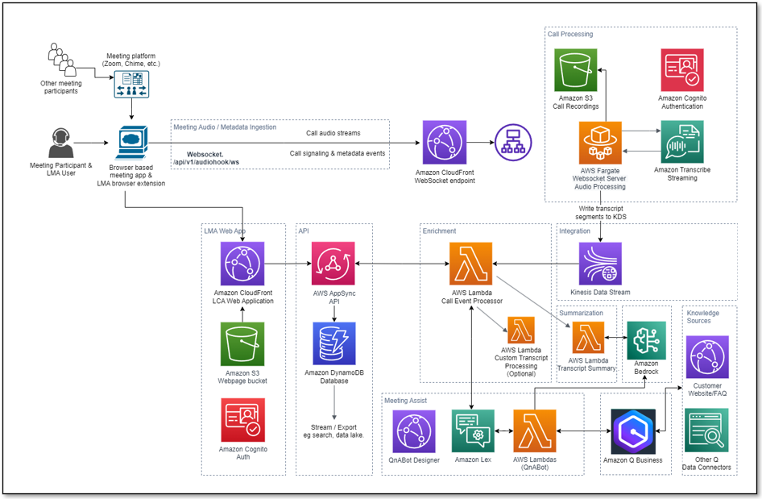

# Live Meeting Assistant (LMA)

**An AI teammate in your meetings, not just a note taker.** LMA joins your Zoom, Microsoft Teams, Google Meet, Webex and Amazon Chime meetings. It transcribes and translates them live and names every speaker, including people sharing one conference-room microphone. It answers questions as the meeting happens, and leaves you with summaries, actions, agenda coverage and searchable slides. A consent record on every meeting shows who agreed. It runs entirely in your own AWS account, built on Amazon Bedrock, the Strands Agents SDK and Amazon Transcribe.

_Latest release: **v0.4.0**. See the [CHANGELOG](./CHANGELOG.md) for what's new, and the [v0.4.0 upgrade notes](./docs/stack-updates-and-upgrades.md#v040) before updating an existing stack._

**📖 [Documentation](https://aws-samples.github.io/amazon-transcribe-live-meeting-assistant/)** · **🎬 [LMA in Action](https://aws-samples.github.io/amazon-transcribe-live-meeting-assistant/lma-in-action/)**, an illustrated tour · **[Demo videos](./docs/demo-videos.md)** · 

## See it in action

**Live Meeting Assistant: an AI teammate in your meetings** (about 8 minutes). LMA is invited to a meeting from a pasted invitation, posts its consent notice, names the voices in a shared room, answers questions in the meeting chat, and leaves a summary that tracks the agenda.

https://github.com/user-attachments/assets/ccb1e079-3a9e-4e94-990a-c39043b659dd

More demos, including meeting consent and compliance, an AI coach for a requirements workshop, and what's new in 0.4.0, are on the [Demo videos](./docs/demo-videos.md) page.

## What it does

**It joins the meeting for you, on any platform**
- **Virtual Participant:** paste a meeting link and a Virtual Participant joins Zoom, Teams, Google Meet, Webex or Chime as a guest, now or at a scheduled time. It introduces itself in the chat and leaves when the meeting ends. ([Virtual Participant](./docs/virtual-participant.md))
- **Capture without a bot:** stream from the web app's Stream Audio tab, the Chrome extension, or the native **Desktop Capture App** for macOS and Windows. ([Meeting Sources](./docs/meeting-sources.md))

**A live transcript, in the language you read best**
- **Live transcript:** each line appears seconds after it's spoken, labelled with its speaker, with live translation into 75+ languages. Search it, filter by speaker, and play the recording from any line. ([Transcription & Translation](./docs/transcription-and-translation.md))
- **Speakers named in a shared room:** when several people share one room microphone, LMA tells the voices apart and names each one from what they say, showing the quote it used. With voice enrollment (Beta), LMA users can enroll their own voice so that LMA recognises them in later meetings. ([Voice Enrollment](./docs/voice-enrollment.md))
- **Choice of speech engine:** Amazon Transcribe by default, or an on-demand engine that runs open speech models on AWS Lambda MicroVMs in your account, one per meeting. ([On-demand ASR](./docs/microvm-asr.md))
- **Meeting chat in the transcript:** on Zoom, Teams and Meet, messages sent to everyone become transcript lines under their sender. ([Meeting chat](./docs/virtual-participant.md#meeting-chat-in-the-transcript))

**Ask anything, while it still matters**
- **Meeting assistant:** an agent with tools, not a chatbot over a transcript. It searches this meeting, past meetings, your documents and the web, with quick actions such as *summarize so far*, *list actions*, and *flag actions with no owner or due date*. ([Meeting Assistant](./docs/meeting-assistant.md))
- **Ask from the meeting chat:** anyone in the meeting can type `LMA what was just discussed?` and the answer is posted back to the chat. Chat commands (`LMA help`, `LMA pause`, `LMA leave` and more) control the Virtual Participant. ([Chat commands](./docs/virtual-participant.md#in-meeting-chat-commands))
- **Voice assistant and live interpreter:** Amazon Nova Sonic or ElevenLabs voice answers, an optional animated avatar, and a translator mode that interprets aloud between two languages. ([Voice Assistant](./docs/voice-assistant.md))
- **MCP, both ways:** add tools from Model Context Protocol servers such as Salesforce or your own. LMA is itself an MCP server, so Amazon Quick Suite, Claude Desktop or your own agents can search meetings and send a Virtual Participant. ([MCP Servers](./docs/mcp-servers.md))

**A record you can act on**
- **Summaries and agendas:** summaries, decisions and action items, plus which agenda items were covered, touched on or missed. Summaries are Markdown you can edit, regenerate, download or share. ([Summaries](./docs/transcript-summarization.md), [Agendas](./docs/meeting-agenda.md))
- **Searchable slides:** LMA keeps key frames of the shared screen from the meeting video, reads the text on them, and links each one to the moment it was shown. ([Meeting Video](./docs/meeting-video.md))
- **Ask across all your meetings:** the Meetings Query Tool answers from every meeting you can see and cites them. ([Meetings Query Tool](./docs/meetings-query-tool.md))

**Consent and retention you can prove**
- **Meeting consent:** Off, Notify or Opt-in for each meeting. LMA posts its notice, any objection stops capture, and every meeting keeps a consent record of the notice, the replies (typed or spoken) and the evidence. ([Meeting Consent](./docs/meeting-consent.md))
- **Retention:** keep records and transcripts for as many days as you choose, or delete each transcript once its summary is written. Organisation presets set consent, retention and privacy together. ([Privacy & Data Handling](./docs/privacy-and-data-handling.md))
- **Cost per meeting:** each meeting shows an itemised estimate of what it cost. ([Meeting Cost Estimate](./docs/meeting-cost-estimate.md))

**Yours to run, yours to shape**
- **Your account, your models:** meetings, recordings and models stay in your AWS account and Region, encrypted with your own key. Choose the Bedrock models for the assistant and summaries, and add guardrails.
- **One Configuration page:** named configuration profiles, edited as a form, JSON or YAML, with revision history. ([Configuration Guide](./docs/configuration-guide.md))
- **Operations:** a troubleshooting agent that explains failures from the logs, plus CloudWatch alarms and a dashboard. ([Troubleshooting Agent](./docs/troubleshooting-agent.md), [Monitoring](./docs/monitoring.md))
- **Embeddable:** put the transcript, assistant or Virtual Participant views into your own web applications. ([Embeddable Components](./docs/embeddable-components.md))
- **Open source** under MIT-0: change the prompts, quick actions, summary sections or the code.

## Architecture

A meeting is captured by:
- the Virtual Participant, which runs on AWS Lambda MicroVMs by default;
- the Stream Audio tab;
- the Chrome extension;
- the Desktop Capture App.

Audio streams over a secure WebSocket to the transcriber service on AWS Fargate. That service sends it to the meeting's speech engine: Amazon Transcribe, or an on-demand ASR MicroVM. Transcript segments, chat lines and events flow through Amazon Kinesis Data Streams to the Call Event Processor Lambda. That Lambda works with the Strands Agents SDK, Amazon Bedrock and, optionally, Bedrock Knowledge Bases. Results are stored in Amazon DynamoDB and pushed to the React web app in real time through AWS AppSync subscriptions.

See [Infrastructure & Security](./docs/infrastructure-and-security.md) for the full architecture.

## Quick Deploy

| Region | Launch Stack |
|--------|-------------|
| US East (N. Virginia) |  |
| US West (Oregon) |  |
| Asia Pacific (Tokyo) |  |
| Europe (Ireland) |  |

Deployment takes about 35–40 minutes. Start with the [Quick Start Guide](./docs/quick-start-guide.md) and [Prerequisites & Deployment](./docs/prerequisites-and-deployment.md). If you're updating a stack from 0.3.x, read the [v0.4.0 upgrade notes](./docs/stack-updates-and-upgrades.md#v040) first: several stack parameters moved to the Configuration page.

You are responsible for complying with legal, corporate and ethical restrictions that apply to recording meetings and calls. Do not use this solution to stream, record or transcribe calls if otherwise prohibited. LMA's [meeting consent](./docs/meeting-consent.md) features help you inform participants and record their agreement.

## Cost

You pay for the AWS services a deployment and its meetings use, in your own account:
- **Base infrastructure:** about $10/month for the transcriber service on Fargate and VPC networking, plus a small fixed amount for the CloudWatch alarms and dashboard.
- **Per meeting:** speech recognition, Bedrock model tokens, the voice assistant, and the Virtual Participant's compute, which runs on AWS Lambda MicroVMs by default and is billed while it is in a meeting.

Each meeting's page shows an itemised [cost estimate](./docs/meeting-cost-estimate.md). See [Troubleshooting › Cost Assessment](./docs/troubleshooting.md#cost-assessment) for service pricing links.

## Documentation

The [documentation site](https://aws-samples.github.io/amazon-transcribe-live-meeting-assistant/) is built from [docs/INDEX.md](./docs/INDEX.md). Good starting points:
- [Quick Start Guide](./docs/quick-start-guide.md) and [Prerequisites & Deployment](./docs/prerequisites-and-deployment.md)
- [Meeting Sources](./docs/meeting-sources.md), comparing every way to capture a meeting
- [Virtual Participant](./docs/virtual-participant.md) and [Meeting Consent](./docs/meeting-consent.md)
- [Meeting Assistant](./docs/meeting-assistant.md), [Voice Assistant](./docs/voice-assistant.md) and [MCP Servers](./docs/mcp-servers.md)
- [Configuration Guide](./docs/configuration-guide.md) and [Developer Guide](./docs/developer-guide.md)

## Contributing

Your contributions are always welcome! See [CONTRIBUTING](CONTRIBUTING.md) for more information.

## Security

See [CONTRIBUTING](CONTRIBUTING.md#security-issue-notifications) for more information.

## License

This sample code is made available under the MIT-0 license. See the [LICENSE](LICENSE) file.
