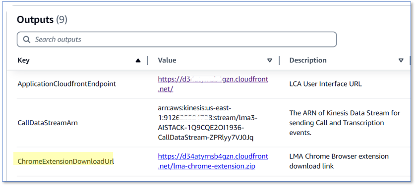
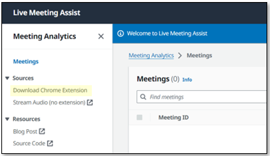
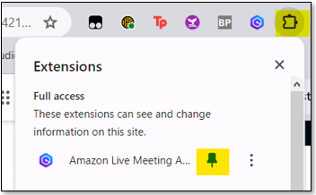
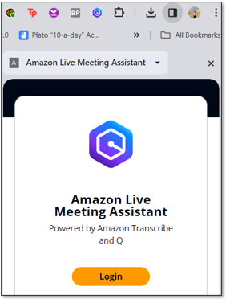
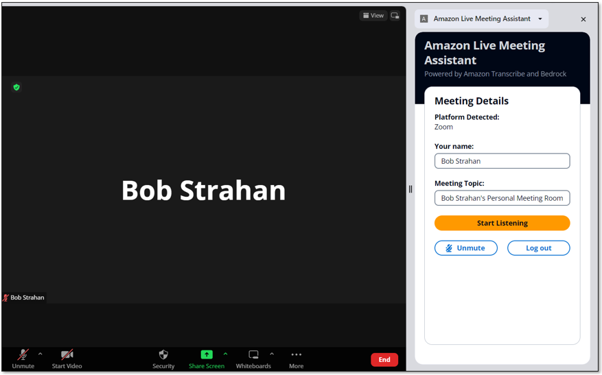
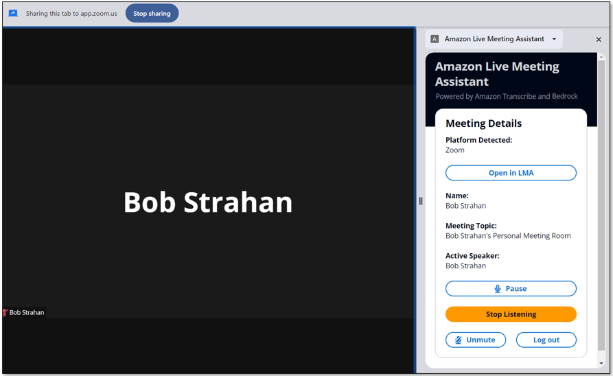

# Chrome Extension

> **Not sure which capture option to use?** See [Meeting Sources](meeting-sources.md) for a side-by-side comparison of the Chrome Extension, Stream Audio/Video, and Virtual Participant.

The extension adds a side panel to meeting tabs on **Zoom, Microsoft Teams, Amazon Chime, Cisco Webex and Google Meet**, capturing both your microphone and the other participants' audio from the tab without adding a bot to the meeting. The [Virtual Participant](virtual-participant.md#google-meet) can also join a Google Meet meeting where the meeting accepts guests from a browser; the extension works whatever the meeting's guest settings, because you are the one in the meeting.

### Download and unzip the extension

During the LMA stack deployment, the nested stack, BROWSEREXTENSIONSTACK, builds a pre-configured browser extension package which is ready to be downloaded and installed in your browser.

Currently only Chrome is supported, but we expect to add extension packages for other browsers later.

To download the Chrome browser extension zip file, either:
- Open the `Outputs` tab of the LMA stack, and choose the download URL labeled `ChromeExtensionDownloadUrl` to download the file `lma-chrome-extension.zip`

  

- OR Open the LMA web application, choose **Chrome Extension** under **Sources** in the side navigation, and click **Download extension** on the Chrome Extension page. The page also includes step-by-step install instructions, usage steps, and a troubleshooting section.

  

After downloading `lma-chrome-extension.zip`, right click and expand the zip file to create a local folder named `lma-chrome-extension`.

### Install the Chrome extension

From within Chrome, navigate to chrome://extensions.  On the left side, click the **Load unpacked**, navigate to the `lma-chrome-extension` folder (which you unzipped from the download), and click select.  This will load your extension.

Pin your new LMA extension to the browser tool bar - select the `extensions` icon and pin the extension `Amazon Live Meeting Assistant`.

   

### Extension version

Chrome shows the LMA version the extension was built from, such as `0.4.1` or `0.4.1.dev1`. Chrome accepts only one to four dot-separated integers in an extension's manifest `version`, so the build puts the LMA version in the manifest's `version_name`, which Chrome displays, and derives `version` from it as follows:

| LMA version | Manifest `version` |
|-------------|--------------------|
| `X.Y.Z.devN` | `X.Y.Z.N` |
| `X.Y.ZaN` | `X.Y.Z.(10000 + N)` |
| `X.Y.ZbN` | `X.Y.Z.(20000 + N)` |
| `X.Y.ZrcN` | `X.Y.Z.(30000 + N)` |
| `X.Y.Z` (a release) | `X.Y.Z.65535` |

Chrome compares the manifest `version` numerically, so a release sorts above every pre-release build of the same `X.Y.Z`, and every build sorts below any build of a later version. Other forms of the LMA version are rejected when the stack is published.

## How to use

Once you have the extension installed, login with your LMA credentials.
  
   

  
Navigate to your meeting platform's page. If you already have it loaded, please reload the page. 

   

  
Select the `Start Listening` button.  
Choose `Allow` on the popup asking you to share the browser tab.
  
   

Choose `Open in LMA` to see your live transcript, select language, and to interact with the meeting assistant.

### Continue an existing meeting

To add to a meeting that already exists, even one shown as **Done**, select
**Continue an existing meeting…** in the panel and paste the meeting's ID, or the
link to its page in LMA, in place of the meeting topic. When you start
listening, the extension asks LMA to reopen the meeting for one more capture
session, then streams into it under the same meeting ID, on the same transcript
timeline. While listening, the panel shows the meeting and its session number.

Only the meeting's owner or an Admin can continue a meeting. LMA does not
reopen a meeting that is still being captured, one whose transcript has been
deleted, or a meeting ID it does not know; the panel shows LMA's reason, and
does not start. The extension reopens the meeting only once the tab's capture
has started, just before streaming. After a reopen, LMA waits up to 15 minutes
for that session to start. If streaming fails after this point, choose **Start
Listening** again: LMA answers with the same session, so the retry is not
refused. A Virtual Participant rejoin, or another user continuing the meeting,
is refused as still being captured until that session has started or the 15
minutes have passed. A package from before this option has no
**Continue an existing meeting…**, and one built without the address of LMA's
API says it cannot continue meetings; download the extension again from LMA. See
[Continuing an existing meeting](websocket-streaming-api.md#continuing-an-existing-meeting).

### Meeting consent

When the deployment's [meeting consent](meeting-consent.md) mode is Notify or
Opt-in, the panel shows a **Meeting consent** step above **Start Listening**.
The extension reads the settings from the transcriber when the panel opens and
again after each capture, so the step always follows the settings in force.

- **The notice** (the consent request in Opt-in), filled with your name and the
  meeting topic. **Copy** puts it on the clipboard; **Post in meeting chat**
  posts it in the meeting chat of the tab, through the same reader that reads
  the meeting's speakers. After posting, the panel asks **Did the notice appear
  in the meeting chat?**: it counts as posted only when you answer **Yes, it
  appeared**, which also chooses *In the meeting chat* as how everyone was told.
  Answer **No**, or if posting failed, copy the notice and paste it yourself,
  or read it out.
- **The confirmation**: in Opt-in, that everyone agreed; in Notify, that you
  told everyone with the notice. With it, **how** (out loud, in the meeting
  chat, or in the invitation's terms), and in Opt-in an optional note. In
  Opt-in, Start is refused until both are given, and nothing is recorded or
  transcribed until the transcriber has recorded your confirmation on the
  meeting. Start is also held while the panel is still reading the settings, and
  while it waits for your answer about the chat post.
- **Participant objected**, while capturing, with an optional name. The
  extension tells the transcriber, which ends the meeting, records the
  objection, and keeps what was captured before it; capture stops at once. If the
  connection to LMA had been lost, the panel says the objection could not be
  sent: record it in the Consent section of the meeting's page in LMA.

The extension sends its step with every START (as mode Off when it could not
read the settings), so the setting **Streaming clients without a consent step**
no longer applies to it. A deployment that refuses such clients can now use the
extension. The consent record names the client "Browser extension". See
[Stream Audio/Video and the Desktop Capture App](meeting-consent.md#stream-audiovideo-and-the-desktop-capture-app)
for what the transcriber records, and when.

### Screen video

The extension can also record the meeting tab as video, stored with the
meeting: the meeting page plays it, and its key frames become the meeting's
shared-screen slides (see [Meeting Video and Key Frames](meeting-video.md)).
It is offered only where an administrator has turned on **Meeting Recording ›
Record screen video from Stream Audio/Video and the browser extension** (off by
default and in every preset) and the deployment records video
(`EnableVideoRecording=true`).

- **Turn it on for one meeting.** Switch on **Also record screen video** before
  **Start Listening**. It is off at the start of every meeting.
- **Only the meeting tab.** The extension records video only when what Chrome
  shares is the meeting tab itself, which it asks for. If anything else is
  shared, the audio is captured as usual, no video is recorded, and the panel
  says so. While the video is on, Chrome's option to switch the share to
  another tab is turned off.
- **While capturing**, **Screen video is ON** shows that the video is being
  recorded. **Stop video** ends the video and keeps the audio.
- **Consent.** With a consent step, the notice ends with "The shared screen is
  also recorded as video.", recorded with the notice; in Opt-in the video starts
  only once the meeting's consent is granted, and an objection ends it with the
  meeting.
- **When the video stops on its own** — the transcriber refuses it, the tab
  stops being shared, or its connection cannot be restored — the panel says
  why and the audio carries on.
- **Key frame spacing.** As on the Stream Audio/Video page, the panel reads the
  spacing of the key frames the browser's encoder produces and warns when they
  are further apart than LMA samples slides at.

The video is sent over a second WebSocket connection, as the Desktop Capture App
and the Stream Audio/Video page send theirs; see
[Screen Video](websocket-streaming-api.md#616-screen-video). Key frames from the
extension are stored with `Source` `BROWSER_EXTENSION`. Firefox is not
supported.

## How meeting speakers are named

Your microphone's lines carry your name. The meeting tab's lines are named from
the meeting page's active speaker, which the extension reads from the page and
sends to LMA each time it changes.

- **Each line is named after whoever the page showed while it was said**, not
  after whoever is showing when the line reaches the transcript, which is a second
  or more later. The server places each change of active speaker on the meeting's
  audio clock as it arrives. Changes are moved back by 0.75 s to allow for the
  page showing a change late. This allowance is the Virtual Participant's value for
  meeting pages; it has not been measured for the extension. An administrator can
  change it with the `SPEAKER_CHANGE_LAG_SECONDS` environment variable on the
  WebSocket transcriber task. This applies on the ASR MicroVM engine, and on Amazon
  Transcribe when speakers within a channel are identified (below). Otherwise,
  Amazon Transcribe lines are named as before.
- **When speakers within a channel are identified**, each line also carries a
  voice id, and the voice corrects the page. Once a voice has been heard for long
  enough alongside one participant, its lines are named after that participant,
  even where the page's indicator is late or flickers, as it does on short replies.
  A voice that starts to carry a second person goes back to the page's names, and
  a [voice enrollment](voice-enrollment.md) name always wins. A voice id is shown
  only under the participant the voice is attributed to, so it does not appear
  under two names. This is the same rule the Virtual Participant uses; see
  [Naming rows from the voice as well](virtual-participant.md#naming-rows-from-the-voice-as-well)
  for its thresholds and for what it did on a measured meeting.

The extension does not choose whether speakers within a channel are identified, so
the deployment default applies: the WebSocket transcriber stack's
`ShowSpeakerLabel` parameter, or **Identify speakers within a channel by default**
on the Configuration page. Both are off unless an administrator turns them on.

When the page shows nobody speaking, the last person it showed carries on. Until
the page has shown anybody, or when the extension cannot read the page (see
below), lines are named as before, after the name the extension started the
meeting with for the other participants.

## If the panel shows no platform, name or active speaker

Audio capture and the meeting readouts come from different parts of the
extension. Audio is captured from whichever tab you share, so it works on any
page. The **Platform Detected**, **Your name** and **Active Speaker** fields come
from a small script that reads the meeting page itself, and that script is
registered for specific meeting hostnames. When a meeting platform changes the
address it serves from, or changes the structure of its page, those three fields
go blank together while the transcript keeps working.

If that happens:

- **Reload the meeting tab** after installing or reloading the extension. The
  page-reading script is only injected into tabs loaded after it.
- **Open the panel once you are in the meeting**, not while you are still in the
  lobby — a lobby page has no participants to read.
- **Type your name and the meeting topic by hand.** Both fields are editable, and
  anything you type is kept rather than overwritten. Your name is pre-filled from
  your LMA login when the meeting page does not supply one.
- **Check the hostname in your address bar.** Microsoft serves Teams from both
  `teams.microsoft.com` and `teams.cloud.microsoft`, and Zoom from several
  regional `zoom.us` hosts; all of these are supported, but a host not on the
  list loads no reader. If you are on an address not listed above, please
  [open an issue](https://github.com/aws-samples/amazon-transcribe-live-meeting-assistant/issues)
  with the hostname.
- **Active Speaker is only shown while listening**, and only on platforms that
  expose who is speaking in their page. A blank active speaker does not affect
  the transcript, which is produced from the audio.

## Automated tests

Three layers cover the extension:

- **Unit tests** (`npm test` in `lma-browser-extension-stack`) for the panel's
  own logic.
- **A browser smoke test** (`make test-browser-extension-e2e`, after `npm run
  build`), run by CI on every pull request that changes the extension. It loads
  the build into headless Chromium with Playwright and checks that the service
  worker and side panel start, that the extension's id is the one the Cognito
  app client accepts as its sign-in callback, that the sign-in screen and the
  signed-in panel render, that **Login** starts the hosted sign-in and exchanges
  the code it returns, and that the recorder is injected into pages. Nothing
  reaches the network: the test answers or refuses every request.
- **A live test** against a deployed stack, `integ-tests/test_browser_extension.py`
  (opt-in; see [`integ-tests/README.md`](../integ-tests/README.md)). It signs in
  on the hosted page, captures a stand-in meeting tab and a fake microphone, and
  checks the transcript on the stack, then continues that meeting.

What none of them does is capture a real meeting platform's tab: the live test
plays a recording into a local page, and the share prompt is accepted by a
Chromium switch rather than by a person.
