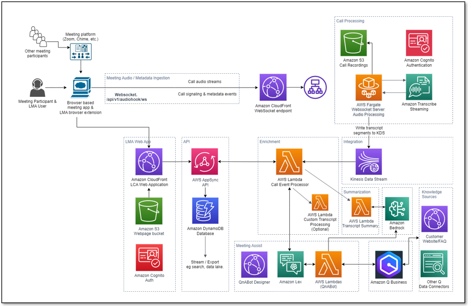

# Infrastructure & Security

## Table of Contents

- [Overview](#overview)
- [Architecture Diagram](#architecture-diagram)
- [Processing Flow](#processing-flow)
- [Nested Stack Structure](#nested-stack-structure)
- [Authentication](#authentication)
- [Encryption](#encryption)
- [Integration Credentials](#integration-credentials)
- [Networking](#networking)
- [WAF (Web Application Firewall)](#waf-web-application-firewall)
- [CloudFront CDN](#cloudfront-cdn)
- [IAM](#iam)
- [Observability](#observability)
- [Data Retention](#data-retention)
- [Related Documentation](#related-documentation)

## Overview

LMA is deployed as a set of 11 nested CloudFormation stacks providing a fully serverless, event-driven architecture. This document describes the infrastructure components, security controls, and operational characteristics of the system.

## Architecture Diagram



## Processing Flow

1. **User starts meeting** via the Stream Audio tab or by launching a Virtual Participant.
2. A **secure WebSocket connection** is established to the Fargate-based WebSocket server.
3. **Two-channel audio** is streamed to Amazon Transcribe.
4. **Transcription results** are written to a Kinesis Data Stream in real time.
5. The **Call Event Processor Lambda** consumes from Kinesis, processes transcript segments, and integrates with the Strands agent for meeting assistance.
6. **Results are persisted** to DynamoDB via AppSync mutations.
7. **Real-time updates** are pushed to the UI via AppSync GraphQL subscriptions.
8. **End-to-end latency** is typically a few seconds.

## Nested Stack Structure

| Stack | Purpose |
|-------|---------|
| lma-ai-stack | Core stack: Lambda functions, AppSync API, DynamoDB, Cognito, CloudFront UI |
| lma-websocket-transcriber-stack | WebSocket server on ECS Fargate with Application Load Balancer |
| lma-virtual-participant-stack | VP ECS tasks and Step Functions scheduler |
| lma-vpc-stack | VPC, public/private subnets (2 AZs), NAT gateway, security groups |
| lma-cognito-stack | Cognito User Pool and Identity Pool |
| lma-meetingassist-setup-stack | Strands agent configuration |
| lma-bedrockkb-stack | Bedrock Knowledge Base setup |
| lma-llm-template-setup-stack | LLM prompt templates (DynamoDB) |
| lma-chat-button-config-stack | Chat button configuration (DynamoDB) |
| lma-nova-sonic-config-stack | Nova Sonic voice assistant configuration |

## Authentication

LMA uses **Amazon Cognito User Pool** for authentication with the following features:

- Optional multi-factor authentication (MFA)
- JWT token verification with signature validation
- Admin group for elevated access privileges
- Self-registration with configurable email domain restrictions

## Encryption

### At Rest

- **Customer-managed KMS key** encrypts DynamoDB tables, S3 buckets, and CloudWatch Log groups
- All sensitive data is encrypted using AES-256 via KMS

### In Transit

- **HTTPS/TLS** for all connections including WebSocket, AppSync, and CloudFront
- All API communications are encrypted end-to-end

## Integration Credentials

LMA talks to five optional third-party services, and the credential for each is
supplied by you as a CloudFormation parameter. Every one of those values is
held in **AWS Secrets Manager**, in a secret created by the stack and encrypted
with the deployment's customer-managed KMS key. The parameter is still where
you type the key; the stack decides where it is kept.

Each secret is named under the prefix `<stack-name>/integrations/`, alongside
the per-user Zoom sign-in credentials the deployment already keeps at
`<stack-name>/zoom-credentials/<cognito-sub>`:

| Credential | CloudFormation parameter | Secret name | Read by |
|---|---|---|---|
| Tavily API key (web search tool) | `TavilyApiKey` | `<stack-name>/integrations/tavily-api-key` | The meeting assist Lambda, on the first web search of each execution environment |
| ElevenLabs API key (voice assistant) | `ElevenLabsApiKey` | `<stack-name>/integrations/elevenlabs-api-key` | The Virtual Participant container, at task start |
| Simli API key (avatar) | `SimliApiKey` | `<stack-name>/integrations/simli-api-key` | The Virtual Participant container, at task start |
| Zoom Meeting SDK client secret | `ZoomMeetingSdkClientSecret` | `<stack-name>/integrations/zoom-meeting-sdk-client-secret` | The Virtual Participant container, at task start |
| Azure Communication Services connection string | `AcsConnectionString` | `<stack-name>/integrations/acs-connection-string` | The Virtual Participant container, at task start |

A secret is created only when its parameter has a value, so a deployment that
uses none of these features creates none of them.

These secrets are deleted with the stack, regardless of
`EnableDataRetentionOnDelete` — that parameter protects the meeting data a
deployment produced, and these values also exist at the provider and in the
stack parameter.

**How each consumer reads its credential.** The Virtual Participant's ECS task
definition lists the secret's ARN under `Secrets` rather than a value under
`Environment`. The ECS agent resolves it with the **task execution role** and
sets the environment variable in the container when the task starts, so the
value is not part of the task definition and does not appear in
`DescribeTaskDefinition` or the ECS console. The meeting assist Lambda is given
the secret's ARN in `TAVILY_API_KEY_SECRET_ARN` and fetches the value itself,
caching it for the life of the execution environment.

Under `VPLaunchType=MICROVM`, the default, there is no ECS agent, so the MicroVM
launcher Lambda performs the same resolution — on every launch, so that a
rotated credential reaches the next meeting. The delivery route differs from the
ECS one and is worth knowing: a MicroVM takes its configuration from the
Virtual Participant task registry (the `…-VPTaskRegistry` DynamoDB table the AI
stack creates) rather than from an injected environment, so the launcher writes
the resolved values into the `vpConfig` attribute of that participant's item and
the container reads them from there and applies them to its environment before
starting. That table is encrypted with the deployment's customer-managed key and
has point-in-time recovery enabled, each item expires by TTL on `expiresAt`
roughly nine hours after the launch, and the Virtual Participant's own task role
can read items in it.

Every grant is scoped to the specific secret ARNs a deployment was given — no
wildcards — together with `kms:Decrypt` restricted to requests made through
Secrets Manager.

### The 30-day recovery window

Each secret carries a fixed name, which is what makes the rotation procedures
below usable: you address the secret by a name you can predict. The cost is
that Secrets Manager does not remove a deleted secret immediately. It schedules
it for deletion and holds the name for a 30-day recovery window, and creating a
secret of a held name fails. `AWS::SecretsManager::Secret` exposes no way to
shorten that window, so there are two cases to know about.

**Clearing a credential and setting it again inside 30 days.** Blanking
`SimliApiKey` (say) deletes `<stack-name>/integrations/simli-api-key`; putting a
value back within the window fails the stack update on `CreateSecret`, because
the name is still held. This is the likelier of the two cases — no stack
deletion is involved, only two ordinary parameter changes — so if you are
turning a feature off and expect to turn it back on soon, clear the name as
below rather than waiting.

**Deleting a stack and recreating it under the same name inside 30 days.** The
same thing, for every configured credential at once, on the first one
CloudFormation reaches.

Either way, recover by removing the held name outright and retrying:

```bash
aws secretsmanager delete-secret \
  --secret-id <stack-name>/integrations/simli-api-key \
  --force-delete-without-recovery
```

### Bringing your own secret

Each of the five also accepts the ARN of a secret you have already provisioned,
via a companion parameter (`TavilyApiKeySecretArn`,
`ElevenLabsApiKeySecretArn`, `SimliApiKeySecretArn`,
`ZoomMeetingSdkClientSecretArn`, `AcsConnectionStringSecretArn`). Supply the
value or the ARN, not both — the stack refuses a deployment that sets both
forms of the same credential.

A secret you provide must:

- **Live in the same account and the same region as the stack.** The parameters
  accept any well-formed Secrets Manager ARN, because a CloudFormation
  `AllowedPattern` cannot interpolate the stack's own region or account to check
  it, but only a same-account, same-region secret works. The `kms:Decrypt`
  grants are conditioned on `kms:ViaService = secretsmanager.<stack
  region>.<url suffix>`, so a secret in another region is not decryptable;
  and a secret in another account additionally needs a resource policy on the
  secret itself granting the reader, which this stack neither creates nor
  checks for. Either mistake shows up when the credential is first used — a VP
  task that cannot start, or a web search that reports itself unavailable — not
  at deploy time.
- **Hold the credential as its entire `SecretString`**, not as a field of a JSON
  document.
- **Grant `kms:Decrypt` to the reader in its key policy**, if it is encrypted
  with your own KMS key rather than the AWS managed `aws/secretsmanager` key.
  The reader is the Virtual Participant task execution role for the four
  container credentials, or the meeting assist function's role for the Tavily
  key. Under `VPLaunchType=MICROVM` it is the MicroVM launcher function's role
  instead, for the reason given above.

### Rotating a credential

There are two ways to roll a key, and they differ in when it takes effect.

**Through the stack (recommended).** Update the CloudFormation parameter with
the new value and apply the stack update. CloudFormation stores a new version
of the secret. No new task definition revision and no forced ECS deployment are
needed: Virtual Participant tasks are started one per meeting, and the current
version of the secret is read at the start of each one, so the next meeting to
start uses the new value. That holds on every launch type — under
`VPLaunchType=MICROVM` the launcher resolves the secrets per launch for exactly
this reason. For the Tavily key, the stack update replaces the Lambda's
configuration, which retires the existing execution environments, so the new
key is in use on the next invocation.

**Directly in Secrets Manager.** Store a new version of the secret in the
Secrets Manager console or with
`aws secretsmanager put-secret-value --secret-id <stack-name>/integrations/<name>`.
Virtual Participant meetings started after that point use the new value; a
meeting already in progress keeps the value it started with. The meeting
assistant picks the new key up on its next cold start, so a warm function can
keep using the previous key for a few minutes — invoke-and-wait, or apply a
stack update, if you need it to switch immediately.

> If you rotate directly in Secrets Manager, also set the CloudFormation
> parameter to the new value (or move to the matching `...SecretArn` parameter
> and manage the secret entirely yourself). Otherwise the next stack update
> writes the parameter's older value back over the rotated one.

## Networking

- **VPC** with public and private subnets across 2 Availability Zones for high availability
- **NAT gateway** for outbound internet access from private subnets
- **Application Load Balancer** for the WebSocket server endpoint
- **Security groups** for network-level access control between components
- **Optional**: Use an existing VPC and subnets instead of the auto-created network infrastructure

## WAF (Web Application Firewall)

LMA includes an **optional** AWS WAFv2 Web Application Firewall that can restrict access to regional resources by IP address. WAF is **disabled by default** (zero additional cost) and can be enabled by customers who need IP-based access control.

### Configuration

Set the `WAFAllowedIPv4Ranges` parameter to a comma-separated list of IPv4 CIDR ranges to enable WAF:

| Parameter | Default | Description |
|-----------|---------|-------------|
| `WAFAllowedIPv4Ranges` | `0.0.0.0/0` | Allowed IPv4 CIDR ranges. Default disables WAF. Example: `192.168.1.0/24, 10.0.0.0/16` |

### How it works

- **Disabled (default)**: When set to `0.0.0.0/0`, no WAF resources are created. All IPs can access the API.
- **Enabled**: When set to specific CIDR ranges, a REGIONAL WAFv2 WebACL is created with an IP-based allow-list rule. The default action is **Block**, meaning only traffic from the specified IP ranges is allowed.

### Protected resources

When WAF is enabled, the WebACL is automatically associated with:

- **MCP API Gateway** (when `EnableMCPServer` is `true`) — protects the REST API used for API key-authenticated MCP access

The WAF WebACL uses `REGIONAL` scope, making it compatible with API Gateway REST APIs, Application Load Balancers, and AppSync APIs in the same region. Future resources can be associated with the same WebACL by adding additional `AWS::WAFv2::WebACLAssociation` resources.

### Cost

- **WAF disabled (default)**: $0/month
- **WAF enabled**: ~$7/month base (WebACL + rules) + $0.60 per million requests

### API Gateway security

The MCP API Gateway includes the following security controls regardless of WAF enablement:

| Control | Description |
|---------|-------------|
| **Custom Lambda Authorizer** | Validates API keys via SHA-256 hash lookup in DynamoDB |
| **Request Validation** | API Gateway validates request parameters before forwarding |
| **Access Logging** | Structured JSON access logs with per-request details sent to CloudWatch |
| **Execution Logging** | API Gateway execution logs (authorizer decisions, integration telemetry) at INFO level |
| **Throttling** | Rate limiting at 100 req/sec with burst limit of 50 |
| **Metrics** | CloudWatch metrics enabled for monitoring |

## CloudFront CDN

- Configurable **price class**: PriceClass_100 (North America and Europe), PriceClass_200 (adds Asia, Africa, Middle East), or PriceClass_All (all edge locations)
- Optional **geographic restrictions** via ISO 3166-1 alpha-2 country codes to limit access by region

## IAM

- **Least-privilege policies** for all IAM roles created by the stack
- Optional **permissions boundary** via the `InstallationPermissionsBoundaryArn` parameter, applied to all roles created during installation

## Observability

- **AWS X-Ray tracing** for distributed request tracing across Lambda functions and API calls
- **CloudWatch Logs** with configurable retention (1 to 3653 days)
- **CloudWatch metrics** for Lambda, ECS, and AppSync services

## Data Retention

| Data Type | Retention | Configuration |
|-----------|-----------|---------------|
| Meeting records | Configurable, default 90 days | DynamoDB TTL via `MeetingRecordExpirationInDays` parameter |
| Audio recordings | Configurable | S3 lifecycle policy |
| Transcript KB data | Configurable | S3 lifecycle policy |
| CloudWatch logs | Configurable | `CloudWatchLogsExpirationInDays` parameter |

The stack parameter **EnableDataRetentionOnDelete** controls whether DynamoDB tables, S3 buckets, and KMS keys are retained when the stack is deleted. When enabled, these resources persist after stack deletion to prevent data loss.

## Related Documentation

- [CloudFormation Parameters Reference](cloudformation-parameters.md)
- [Troubleshooting](troubleshooting.md)
