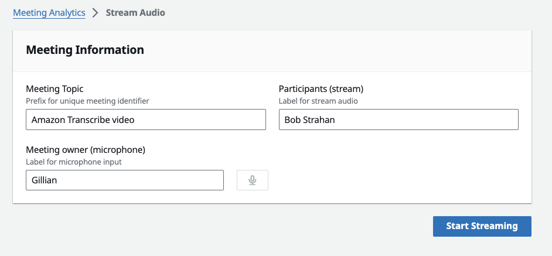
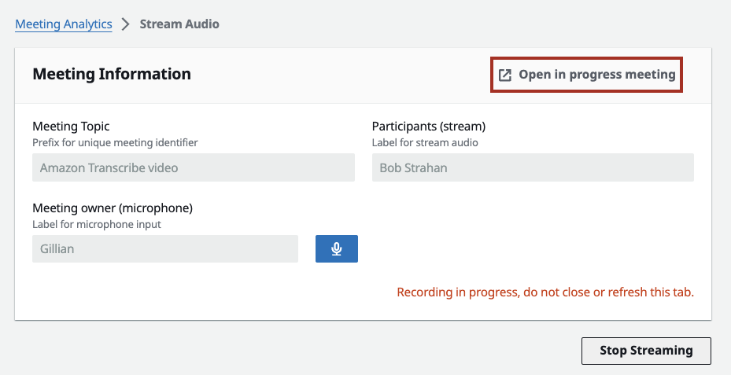
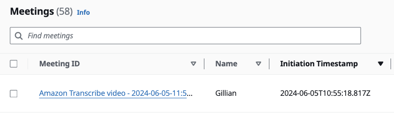
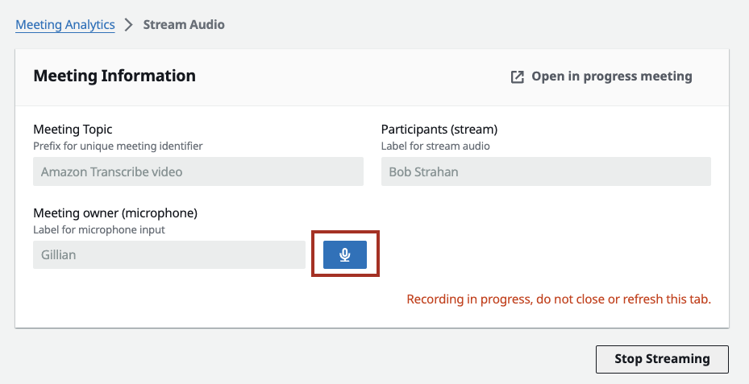
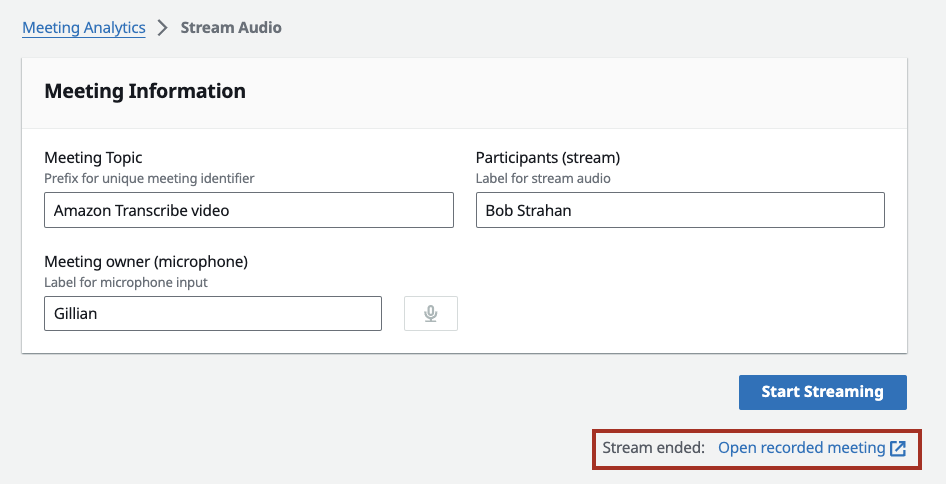

# Stream Audio/Video

## Table of Contents

- [Overview](#overview)
- [Use Cases](#use-cases)
- [Step-by-Step Walkthrough](#step-by-step-walkthrough)
- [Continue an existing meeting](#continue-an-existing-meeting)
- [Meeting Consent](#meeting-consent)
- [Screen Video](#screen-video)
- [Speaker Identification](#speaker-identification)
- [If the Connection Drops](#if-the-connection-drops)
- [Browser Compatibility](#browser-compatibility)
- [Technical Details](#technical-details)
- [Important Notice](#important-notice)
- [See Also](#see-also)

## Overview

> **Not sure which capture option to use?** See [Meeting Sources](meeting-sources.md) for a side-by-side comparison of the Chrome Extension, Stream Audio/Video, and Virtual Participant.

The Stream Audio/Video tab in the LMA web UI lets you capture stereo audio from your Chrome browser -- combining your microphone with any incoming audio source (meeting app, softphone, YouTube, etc.) -- and, where an administrator allows it, to record the shared tab, window or screen as video ([Screen Video](#screen-video)).

## Use Cases

Use Stream Audio/Video with any browser-based audio application when you want to stay in your browser. It works with any audio source playing in Chrome, including:

- Browser-based meeting applications (Amazon Chime, Google Meet, etc.)
- Softphone or VoIP applications running in a browser tab
- YouTube videos or other media for demo and testing purposes
- Any web application that produces audio output

## Step-by-Step Walkthrough

1. **Open any audio source** in a Chrome browser tab (meeting app, softphone, or for demo purposes, a YouTube video).

2. In the LMA UI, navigate to **Stream Audio/Video**.

3. Enter a **Meeting Topic** -- this is appended to the timestamp to create a unique meeting ID.

4. Enter the **Meeting owner (microphone)** -- your name, which is applied to microphone audio for speaker attribution.

5. Enter **Participants (stream)** -- other participants' names, applied to incoming audio for speaker attribution.

6. Optionally enable **Speaker identification** for either channel -- see
   [Speaker Identification](#speaker-identification) below.

7. Click **Start Streaming**.

8. Select the Chrome tab with your audio source, then click **Allow** to share the tab audio.

9. Use the "Open in progress meeting" link to view live transcription. It may take a few seconds for the first transcript segments to appear.

10. The meeting also appears in the meeting list as "In Progress".

11. Use the **mute/unmute button** to control your microphone during the stream.

12. Click **Stop Streaming** to end the session.

13. A link to the recorded meeting appears at the bottom of the Stream Audio/Video page.

## Continue an existing meeting

To add to a meeting that already exists, even one shown as **Done**, select
**Continue an existing meeting…** before you start and paste the meeting's ID,
or the link to its page in LMA (copy it from the browser's address bar on the
meeting page; the Meeting ID is also on the page's **Details** tab). The
**Meeting Topic** is not used: the stream goes into that meeting.

When you click **Start Streaming**, the page asks LMA to reopen the meeting for
one more capture session, then streams into it under the same meeting ID. The
session follows the earlier ones on the meeting's transcript timeline, the
meeting is shown as in progress again, and when you stop, the summary is
generated again over the whole transcript. While streaming, the page says which
session it is and where on the transcript it starts.

Only the meeting's owner or an Admin can continue a meeting; being one of the
people it is shared with is not enough. LMA does not reopen a meeting that is
still being captured, one whose transcript has been deleted, or a meeting ID it
does not know, and the page shows LMA's reason under the Start button without
starting. The page reopens the meeting only once you have shared the tab and
the microphone, just before streaming starts. After a reopen, LMA waits up to
15 minutes for that session to start. If your stream fails to start after this
point (the connection to LMA fails, for example), choose **Start Streaming**
again: LMA answers with the same session, so the retry is not refused. A
Virtual Participant rejoin, or another user continuing the meeting, is refused
as still being captured until that session has started or the 15 minutes have
passed. Each time you continue, the meeting is reopened again for a new
session; a dropped connection reconnects to the same session (see below). See
[Continuing an existing meeting](websocket-streaming-api.md#continuing-an-existing-meeting).

## Meeting Consent

When the deployment's [meeting consent](meeting-consent.md) mode is Notify or
Opt-in, a **Meeting consent** panel appears above the Start button. It shows
the notice to read out or paste into the meeting chat (**Copy notice**), asks
you to confirm that you shared it or, in Opt-in, that everyone agreed, and how;
offers **Capture evidence** to keep a screenshot of the meeting on its consent
record; and, while streaming, **Participant objected**, which stops the stream
and records the objection. In Opt-in, Start is refused until you confirm, and
nothing is recorded or transcribed until the transcriber has recorded your
confirmation on the meeting. See
[Stream Audio/Video and the Desktop Capture App](meeting-consent.md#stream-audiovideo-and-the-desktop-capture-app).

## Screen Video

The page can also record the tab, window or screen you share as video, stored
with the meeting: the meeting page plays it, and its key frames become the
meeting's shared-screen slides (see [Meeting Video and Key Frames](meeting-video.md)).
It is offered only where an administrator has turned on **Meeting Recording ›
Record screen video from Stream Audio/Video and the browser extension** on the
Configuration page (off by default and in every preset) and the deployment
records video (`EnableVideoRecording=true`).

- **Turn it on for one meeting.** Switch on **Also record screen video** before
  **Start Streaming**. It is off at the start of every meeting. The browser
  needs MediaRecorder with MP4 (H.264) recording, as recent Chrome and Edge
  have; where it is missing the switch is disabled and says so.
- **What you share.** After you pick what to share, the page names it (a browser
  tab, a window, or your whole screen) and shows a small preview of what is
  recorded. Sharing the whole screen records everything on it, including
  notifications and other windows, and the page warns you: share only the
  meeting's tab or window where you can.
- **While streaming**, **Screen video is ON** shows that the video is being
  recorded. **Stop video** ends the video and keeps the audio streaming; the
  video cannot be started again in the same meeting.
- **Consent.** When the meeting has a consent step, the notice ends with the
  deployment's video sentence (Meeting Consent › **Video sentence**), which is
  recorded on the meeting's consent record with the notice. Once you copy the
  notice or confirm that it was given, the video switch is fixed for the
  meeting, since the notice says whether the screen is recorded. In Opt-in, the video starts only
  once the meeting's consent is granted; an objection ends the meeting and its
  video, and keeps what was recorded until then.
- **When the video stops on its own** — the transcriber refuses it, you stop
  sharing, or its connection cannot be restored within about two minutes — the
  page says why and the audio carries on.
- **Key frame spacing.** LMA takes slides from H.264 key frames, which it needs
  at least every two seconds. The page asks the browser's encoder for one every
  1.8 seconds and reads the spacing it actually gets from the video; if the
  encoder spaces them further apart, the page warns that some slides may be
  missed, and records the video anyway.

The video is sent as the Desktop Capture App sends its own, over a second
WebSocket connection; see [Screen Video](websocket-streaming-api.md#616-screen-video).
Key frames from this page are stored with `Source` `STREAM_AUDIO`.

## Speaker Identification

The names you enter above give one speaker name per channel: everything from the
shared tab is attributed to **Participants (stream)** and everything from your mic
to **Meeting owner (microphone)**. That is enough for a one-to-one conversation,
but not when several people share a channel.

Enable **Speaker identification** to have Amazon Transcribe tell those voices
apart. Each channel is controlled independently, so you can turn on either, both,
or neither:

| Setting | Turn it on when |
|---|---|
| Identify separate speakers in the shared tab audio | The captured call has several remote participants |
| Identify separate speakers on my microphone | Several people share your microphone, e.g. in a meeting room |

Distinct voices are appended to the channel's name as `(spk_0)`, `(spk_1)`, and so
on -- for example `Other Participant (spk_0)` and `Other Participant (spk_1)`. The
transcript then shows each voice as its own turn, and the labels also reach the
meeting summary and the Meeting Assistant.

Notes:

- Both settings are **off by default** and can only be changed before you start
  streaming.
- Speakers are numbered **per channel**, each starting at `spk_0`.
- A segment gets its label when it finalizes, so it briefly appears without one
  while still being transcribed.
- Accuracy is best with **five or fewer voices per channel**.
- Labels are numbers, not names -- Transcribe distinguishes voices but does not
  identify who they belong to. If you need real names for meeting participants,
  use the [Chrome Extension](browser-extension.md) or a
  [Virtual Participant](virtual-participant.md), which read them from the meeting
  and, with speaker identification on, use the voices to correct the meeting
  page's speaker names (see
  [How meeting speakers are named](browser-extension.md#how-meeting-speakers-are-named)).
  Stream Audio/Video has no meeting page to read, so its labels are unchanged.
- There is no additional Amazon Transcribe charge for speaker identification.

## If the Connection Drops

If the page's connection to LMA drops while you are streaming (for example on a
change of network), the page keeps capturing and reconnects on its own, after 1, 2 and 4 seconds and then
every 5 seconds. Each time it connects it signs in with your current session and
continues the same meeting: the transcript and the recording carry on in the same
meeting, with one recording. The page keeps the last 3 seconds of audio captured
while it was disconnected and sends them once it has reconnected; anything said
earlier in the outage is missing from both the transcript and the recording.

LMA holds a meeting whose connection dropped for 60 seconds. If the page cannot
reconnect within 55 seconds, it stops streaming and shows **Connection lost:
meeting ended**. The meeting keeps everything captured before the drop and has
its summary as usual, and **Open recorded meeting** opens it. Click **Start
Streaming** to continue in a new meeting. The 55 seconds count from when the
browser notices the connection is gone, which for a network that fails silently
can be some time after it failed. If LMA has already ended the meeting by the
time the page reconnects, the page's audio goes to a second session of the same
meeting, as described under
[Reconnection](websocket-streaming-api.md#reconnection). The same happens
when the reconnection reaches a different transcription server task than the
one holding the meeting, on deployments that run more than one.

## Browser Compatibility

Chrome browser is required. Stream Audio/Video relies on Chrome's tab audio capture API to capture audio from other browser tabs. Other browsers do not support this capability.

## Technical Details

Stream Audio/Video combines your microphone input and the selected tab's audio into a stereo (two-channel) audio stream. Your microphone is assigned to one channel while the tab audio is assigned to the other, enabling speaker attribution during transcription. The combined stream is sent via WebSocket to the Fargate-based transcription server for real-time processing.

Because attribution is per channel, several people sharing one microphone appear
as a single speaker unless you tick the **Speaker identification** boxes above.
Your speaker-identification choices are sent once, in the session's opening
message, and the server enables speaker partitioning for the channels you chose.
Which engine does the partitioning depends on the deployment: Amazon Transcribe by
default, or the [ASR MicroVM engine](microvm-asr.md) where it is deployed and an admin
has moved these meetings onto it. See [WebSocket Streaming API](websocket-streaming-api.md#speaker-identification-diarization)
for the protocol details.

## Important Notice

Always obtain permission from all participants before recording a meeting or conversation. Recording others without their knowledge or consent may violate local laws and organizational policies.

## See Also

- [Upload Audio](upload-audio.md) -- Transcribe an existing audio/video recording instead of streaming live
- [Virtual Participant](virtual-participant.md) -- Join meetings as a separate automated participant
- [WebSocket Streaming API](websocket-streaming-api.md) -- Technical details on the streaming protocol
- [On-demand ASR & Speaker Diarization (MicroVM)](microvm-asr.md) -- Label the transcript per voice rather than per audio channel
