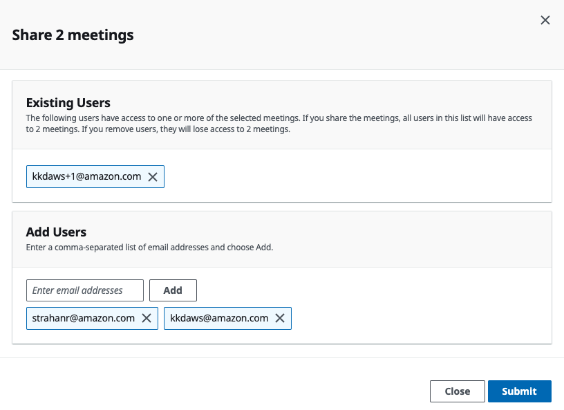
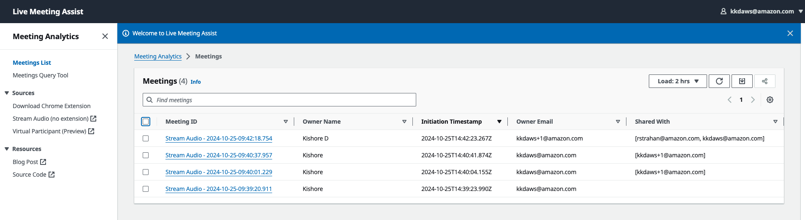
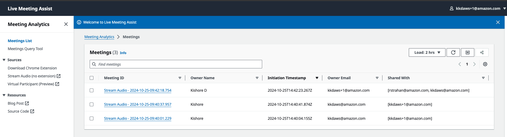
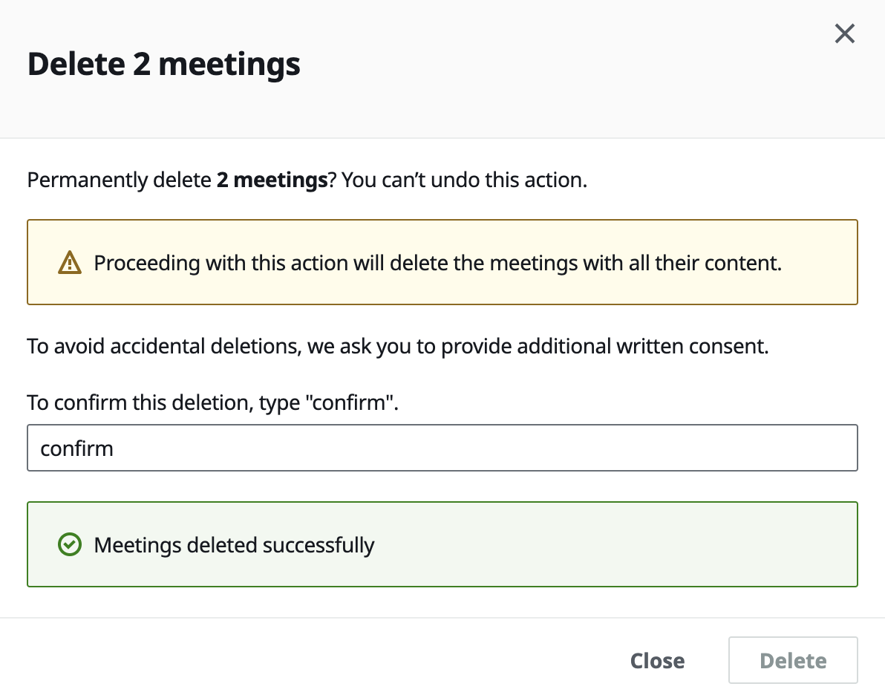

# User-Based Access Control

## Table of Contents

- [Overview](#overview)
- [Roles](#roles)
- [Admin User](#admin-user)
- [Non-Admin User](#non-admin-user)
- [Participant](#participant)
- [Authorized Account Email Domain](#authorized-account-email-domain)
- [Meeting Sharing](#meeting-sharing)
- [Recording Playback](#recording-playback)
- [Meeting Deletion](#meeting-deletion)
- [Knowledge Base Search](#knowledge-base-search)
- [Upgrading from v0.1.9 or Earlier](#upgrading-from-v019-or-earlier)
- [Service Limits](#service-limits)

## Overview

Starting with v0.2.0, LMA provides User-Based Access Control (UBAC). Each non-admin user sees only their own meetings and meetings that have been explicitly shared with them. Admin users can see all meetings across all users. This ensures meeting privacy while still allowing collaboration through sharing.

## Roles

Every LMA account has exactly one of three roles, decided by its Amazon Cognito
group membership:

- **Admin**: a member of the `Admin` group.
- **Participant**: a member of the `Participant` group and not of `Admin`.
- **User**: an account in neither group. Every account created before the
  Participant role existed, and every self-registered account, is a User.

Admins choose a user's role on the [User Management](user-management.md) page.

### What each role can use

The table lists what each role can use. It is generated from the role matrix,
`lma-ai-stack/source/appsync/role-matrix.json`, which names the roles of every
GraphQL operation and every other entry point; the schema and the services named
below are tested against it, so the table and the deployed behaviour agree.

<!-- role-table:start -->
| Capability | Admin | User | Participant | Notes |
|---|---|---|---|---|
| Participant home page | No | No | Yes | Admins and Users open the meetings list instead. |
| Meetings list and meeting pages: transcripts, summaries, recordings, key frames, notifications, whiteboards, archives and cost | Yes | Yes | No | Admin: every meeting. User: their own meetings and those shared with them. |
| Editing, sharing, deleting and reopening meetings: speakers, summaries, agendas, preparation, labels, guidance and whiteboards | Yes | Yes | No | Admin: every meeting. User: the meetings each operation's own rule allows (sharing and deleting: their own). |
| Meeting consent records | Yes | Yes | No | Admin: every meeting. User: the meetings they own or that are shared with them. |
| Meeting assistant chat, the Meetings Query Tool, the knowledge base, and reading the installed MCP servers and skills | Yes | Yes | No |  |
| Meeting sources: Stream Audio/Video, Upload Audio, the browser extension and the Desktop Capture App | Yes | Yes | No |  |
| Virtual Participant: launch, schedule, view, share, end and rejoin | Yes | Yes | No | Admin: every Virtual Participant. User: their own and those shared with them. |
| AWS credentials the web UI signs its own requests with: recording playback and file links, transcript translation, the deployment settings, and Virtual Participant launch | Yes | Yes | No |  |
| MCP API keys and the hosted MCP server (API key and OAuth endpoints) | Yes | Yes | No | Admin: every meeting through MCP. User: their own meetings and those shared with them. |
| Enrolling your own voice | Yes | Yes | No |  |
| Configuration: settings, profiles and their history, prompt templates, chat buttons, voice assistant, transcription engine and cost prices | Yes | No | No |  |
| Installing and changing MCP servers and skills, and importing or exporting their libraries | Yes | No | No |  |
| User Management: adding and deleting users and choosing their roles | Yes | No | No |  |
| Troubleshooting agent | Yes | No | No |  |
<!-- role-table:end -->

### How the roles are applied

Every token the user pool issues names the caller's role. A Cognito pre token
generation trigger (`lma-cognito-stack`) writes the role into the token's
`cognito:groups` claim, replacing the role groups and keeping any other group,
so an account in no group carries `User`; it also adds the role to the ID token
as the `lma_role` claim. The trigger runs at every sign-in, whether through the
web UI, the browser extension or the Desktop Capture App, and at every token
refresh. A change of role therefore reaches a user's tokens at their next
sign-in or token refresh, which is at most an hour later.

Each entry point then admits only the roles the role matrix lists for it:

- **AppSync GraphQL API.** Every query, mutation and subscription names the
  roles that may call it (`@aws_cognito_user_pools(cognito_groups: [...])`), and
  a field that names none is refused to every signed-in caller. Resolvers still
  apply their per-meeting rules (owner, shared with, Admin) on top.
- **WebSocket transcriber (Stream Audio/Video page, browser extension, Desktop Capture App).**
  The transcriber verifies the access token on every request and answers `403`
  to a role that may not stream meetings.
- **Cognito identity pool credentials for the web UI.** The web UI signs some
  requests itself: recording playback and file links, transcript translation,
  the deployment settings and Virtual Participant launch. The identity pool
  chooses the IAM role from the `lma_role` claim: Admins and Users receive the
  web UI's role, Participants a role with no permissions, and a token naming no
  role receives no credentials.
- **Hosted MCP server, API key endpoint.** The API key authorizer reads the key
  owner's current groups from the user pool on every request. A key works only
  while its owner's role includes MCP access, and only while the owner exists;
  whether the caller is treated as an Admin also follows their current groups.
- **Hosted MCP server, OAuth gateway.** The MCP server reads the role from the
  `cognito:groups` claim the gateway forwards and refuses a role without MCP
  access.
- **Web UI.** Navigation and pages follow the role; a page the role may not use
  shows **Access denied**. This is presentation: the entry points above are what
  refuse the request.

LMA declares no Lambda function URLs; a test fails if a template adds one.

## Admin User

The stack creator or updater is automatically assigned the "Admin" role in Amazon Cognito.

Admin users have the following privileges:
- Can see **all meetings** across all users
- Can share any meeting with other users
- Can delete any meeting

**Recommendation**: Use the `jdoe+admin@example.com` email format for your admin account. This separates your admin account from your personal account, allowing you to have a non-admin account for day-to-day use while retaining admin access when needed.

## Non-Admin User

Non-admin users sign up via the LMA web UI. Their email address must belong to one of the configured Authorized Account Email Domains.

Non-admin users:
- Only see meetings they **own** or that have been **shared with them**
- Can share and delete only their own meetings
- Cannot access admin configuration pages

Each transcript line a meeting stores, whether speech, a meeting-chat line or a
meeting-assistant answer, carries the meeting's owner and its sharing list, as
each video key frame does. Both are read from the meeting record when the line
is written, not taken from the event that carried it. A non-admin user is
answered the lines whose owner is them or whose sharing list names them, in the
transcript query and in the live subscription. Lines stored by earlier versions
are left as they are: speech and chat lines carry the sharing list, and an owner
only where the producer sent an access token; meeting-assistant answers carry no
sharing list. All of them are returned to Admins, and speech and chat lines also
to the users the meeting is shared with.

## Participant

A Participant account is for someone who takes part in meetings without using
LMA to capture them, for example a guest from another organization. An Admin
creates it, or changes an existing account to it, on the
[User Management](user-management.md) page.

A Participant signs in to a home page that says their meetings and consents will
appear there, and nothing else: no meetings list or meeting pages, no meeting
sources (Stream Audio/Video, Upload Audio, Virtual Participant, browser
extension, Desktop Capture App), no meeting assistant, MCP access or voice
enrollment, and no configuration. Opening any other page shows **Access
denied**. The browser extension and the Desktop Capture App accept a
Participant's sign-in, and the transcriber then refuses their connection.

## Authorized Account Email Domain

The Authorized Account Email Domain setting controls who can self-register for an LMA account.

- Configured during deployment as a CloudFormation parameter
- Accepts a **comma-separated list** of email domains (e.g., `example.com,acme.org`)
- Users with an email address matching one of the listed domains can self-register through the web UI
- Leave blank to **prevent self-registration** entirely (only the admin account will exist)

## Meeting Sharing

*Available since v0.2.5*

Meeting sharing allows owners to grant read-only access to other users.

### How to Share

1. Select one or more owned meetings from the meeting list

   

2. Click the share icon in the toolbar

3. Enter comma-separated email addresses and click **Add**

4. Remove existing shared users if needed

   

5. Click **Submit**

6. Wait for the success confirmation

   

### Sharing Behavior

- Shared meetings appear in recipients' meeting lists with **read-only access**
- You can share **live meetings** that are still in progress (there is a small chance of missing transcript segments during the sharing operation)
- You can share with users who have **not yet signed up** — they must create an account to view the shared meeting
- Sharing does **not** validate recipient email addresses against the Authorized Email Domain setting
- Recipients do **not** receive an email notification when a meeting is shared with them

### Viewing Shared Meetings

Different users see different meeting lists based on ownership and sharing:

## Recording Playback

Meeting *metadata* — the meeting list, transcript segments, summaries and meeting-assistant
history — is served by the AppSync GraphQL API, and the owner / shared-with rules described
above are applied there before any result is returned.

The audio and video *recordings* travel on a separate path. The meeting record stores the
recording's S3 location, and the web UI's players sign their own `GET` for that object using
the browser's Amazon Cognito identity-pool credentials, reading the media directly from S3
rather than through AppSync or CloudFront. A signed link is generated when playback starts
and is short-lived.

Those identity-pool credentials come from the `CognitoAuthorizedRole` in
`lma-cognito-stack`, whose S3 grant is limited to the two key prefixes the players read —
the audio recordings prefix (`lma-audio-recordings/`) and the video recordings prefix
(`lma-video-recordings/`). The other prefixes in the recordings bucket, such as
`lma-transcripts/`, `lma-uploads-pending/` and `lma-video-chunks/`, are reachable only by
the backend roles that own them. If a future release adds another prefix that the players
read, that prefix has to be added to the same grant.

If your organisation requires recording playback to be governed by the same per-meeting
decision as the metadata, plan for that decision to be applied where the playback link is
produced, which today is the web UI.

## Meeting Deletion

*Available since v0.2.7*

Meeting owners can permanently delete their meetings.

### How to Delete

1. Select one or more owned meetings from the meeting list

   

2. Click the delete icon in the toolbar

3. Type "confirm" in the confirmation dialog

   

4. Click **Delete**

5. Wait for the success confirmation

   

### Deletion Behavior

- Deleted meetings are **automatically removed** from shared users' meeting lists
- Shared users do **not** receive a notification when a meeting they can access is deleted
- Deletion cannot be undone from LMA. It deletes the meeting record, its
  transcript, summary, consent record, key frames and usage records, every
  version of its recordings and files in the recordings bucket, and every
  Virtual Participant record that names it. The full list is in
  [Deleting a meeting](privacy-and-data-handling.md#deleting-a-meeting)
- The deleted items remain restorable for 35 days from the DynamoDB tables'
  point-in-time recovery, by someone with access to the AWS account; the
  recordings and files are not, because every version is deleted. Records that
  already passed through the Kinesis and DynamoDB streams (24 hours), CloudWatch
  logs, and anything already downloaded are not affected; see
  [Copies that follow their own lifetime](privacy-and-data-handling.md#copies-that-follow-their-own-lifetime)
- If any step fails, the meeting is not deleted and stays in the list; deleting
  it again repeats every step

### Deleting Meetings by Label

[`lma meetings delete --label key=value --user-name <user>`](lma-cli.md#lma-meetings-delete--delete-meetings-by-label)
deletes every meeting that carries the labels, through the same per-meeting
deletion. It acts for the LMA user named: an Admin's selection is every user's
matching meetings, anyone else's only the ones they own, and the deletion checks
that again for each meeting. It is a dry run unless `--confirm` is given, and it
skips meetings still in progress.

As [the CLI reference](lma-cli.md#lma-meetings-delete--delete-meetings-by-label)
says, the command acts with the caller's AWS credentials, which are what permit
it; its table lists the AWS actions they need. `--user-name` chooses which
meetings are selected, by the rules above.

## Knowledge Base Search

The transcript knowledge base (`TranscriptKnowledgeBase`) holds every meeting's
transcript and summary files, with the meeting's owner in each file's metadata.
Every search of it is filtered on that owner, except an Admin's:

- The meeting assistant's `meeting_history` tool searches only the meetings
  owned by the user it acts for: the signed-in user on the meeting page, or,
  for a request made in the meeting that is allowed past meetings, the meeting's
  owner.
- The **Meetings Query** page searches only the signed-in user's own meetings,
  and every meeting for a member of the Admin group, who can read every meeting
  anyway.
- The MCP server's `search_meetings` tool, likewise, filters a non-Admin
  caller's search on that caller and does not filter an Admin's.

A meeting shared with a user is not found by that user's search; only its owner's
and an Admin's searches find it. So one user's assistant never reaches another
user's meetings. An in-meeting request that is allowed past meetings reaches all
of the owner's meetings, including meetings with other organizations, which is
why **In-meeting requests** is **Current meeting only** by default and in every
configuration preset.

## Upgrading from v0.1.9 or Earlier

Upgrading to v0.2.0 or later from v0.1.9 or earlier introduces a **breaking change**: the Amazon Cognito user pool is deleted and recreated. All users (admin and non-admin) must re-register.

### What to Expect

- **Admin user**: Receives a new temporary password email. After signing in and setting a new password, the admin retains access to **all previous meetings**.
- **Non-admin users**: Must create new accounts via the web UI. They will **lose access** to their previous meetings unless the admin shares those meetings with them.

### Recommendations

- Change the admin email to `jdoe+admin@example.com` format during the upgrade to separate admin and personal accounts
- Communicate the upgrade to non-admin users in advance so they know to re-register
- After upgrade, the admin can share previous meetings with users who need access

## Service Limits

Amazon Transcribe has a default limit of **25 concurrent transcription streams**. If your organization runs many simultaneous meetings, you may need to request a service limit increase through the AWS console.

---

See also: [Prerequisites & Deployment](prerequisites-and-deployment.md) | [Web UI Guide](web-ui-guide.md)
