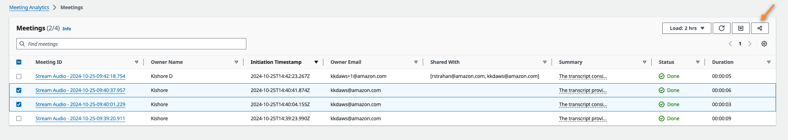
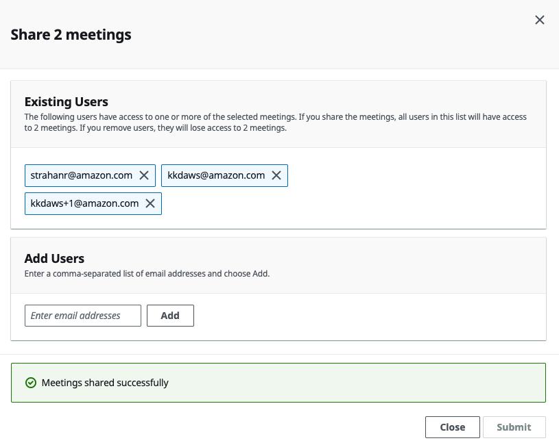
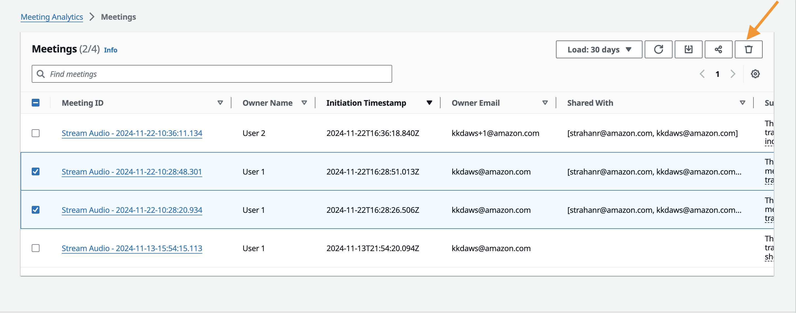
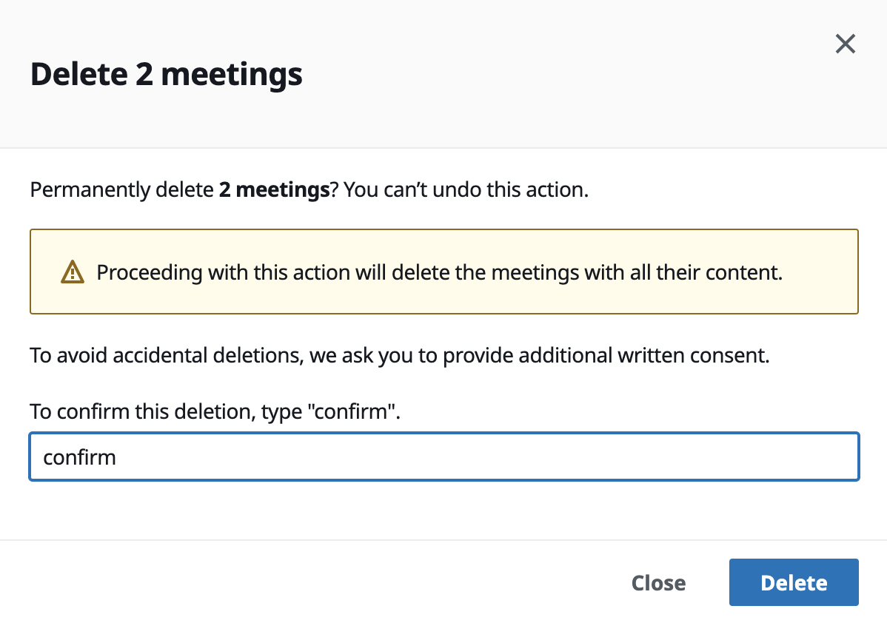

# User-Based Access Control

## Table of Contents

- [Overview](#overview)
- [Roles](#roles)
- [Admin User](#admin-user)
- [Non-Admin User](#non-admin-user)
- [Participant](#participant)
- [Authorized Account Email Domain](#authorized-account-email-domain)
- [Meeting Sharing](#meeting-sharing)
- [Recording Playback](#recording-playback)
- [Meeting Deletion](#meeting-deletion)
- [Knowledge Base Search](#knowledge-base-search)
- [Upgrading from v0.1.9 or Earlier](#upgrading-from-v019-or-earlier)
- [Service Limits](#service-limits)

## Overview

Starting with v0.2.0, LMA provides User-Based Access Control (UBAC). Each non-admin user sees only their own meetings and meetings that have been explicitly shared with them. Admin users can see all meetings across all users. This ensures meeting privacy while still allowing collaboration through sharing.

## Roles

Every LMA account has exactly one of three roles, decided by its Amazon Cognito
group membership:

- **Admin**: a member of the `Admin` group.
- **Participant**: a member of the `Participant` group and not of `Admin`.
- **User**: an account in neither group. Every account created before the
  Participant role existed, and every self-registered account, is a User.

Admins choose a user's role on the [User Management](user-management.md) page.

### What each role can use

The table lists what each role can use. It is generated from the role matrix,
`lma-ai-stack/source/appsync/role-matrix.json`, which names the roles of every
GraphQL operation and every other entry point; the schema and the services named
below are tested against it, so the table and the deployed behaviour agree.

<!-- role-table:start -->
| Capability | Admin | User | Participant | Notes |
|---|---|---|---|---|
| Participant home page | No | No | Yes | Admins and Users open the meetings list instead. |
| A Participant's read-only view of the meetings shared with them: the list, and each meeting's transcript (live while it is in progress), summary, meeting chat, recordings and consent record | No | No | Yes | Only meetings whose sharing list names them. Not the owner's own material: the meeting context, checklist, labels, guidance, whiteboards, the assistant's answers, the sharing list and the participant addresses. Recordings play through links the server signs for the meeting; the identity pool gives a Participant transcript translation only. |
| Meetings list and meeting pages: transcripts, summaries, recordings, key frames, notifications, whiteboards, archives and cost | Yes | Yes | No | Admin: every meeting. User: their own meetings and those shared with them. |
| Editing, sharing, deleting and reopening meetings: speakers, summaries, agendas, preparation, labels, guidance and whiteboards | Yes | Yes | No | Admin: every meeting. User: the meetings each operation's own rule allows (sharing and deleting: their own). |
| Meeting consent records | Yes | Yes | No | Admin: every meeting. User: the meetings they own or that are shared with them. |
| The meeting assistant chat on a meeting's page | Yes | Yes | Yes | Admin: every meeting. User: their own meetings and those shared with them. Participant: the meetings shared with them, answered with the tools approved for Participant use and from that meeting only, and not added to its transcript. |
| The Meetings Query Tool, the knowledge base, the chat buttons, the meeting page's chat notifications, and reading the installed MCP servers and skills | Yes | Yes | No |  |
| Meeting sources: Stream Audio/Video, Upload Audio, the browser extension and the Desktop Capture App | Yes | Yes | No |  |
| Virtual Participant: launch, schedule, view, share, end and rejoin | Yes | Yes | No | Admin: every Virtual Participant. User: their own and those shared with them. |
| AWS credentials the web UI signs its own requests with: recording playback and file links, the deployment settings, and Virtual Participant launch | Yes | Yes | No |  |
| Translating a meeting's transcript (the Translate switch), with the web UI's identity pool credentials | Yes | Yes | Yes | Participant: on the meetings shared with them. Their identity pool role allows Amazon Translate's TranslateText and the Amazon Comprehend language detection it uses, and nothing else. Translation is billed per character to the deployment's AWS account, for every role alike. |
| MCP API keys and the hosted MCP server (API key and OAuth endpoints) | Yes | Yes | No | Admin: every meeting through MCP. User: their own meetings and those shared with them. |
| Enrolling your own voice | Yes | Yes | Yes | Each person their own voice only: enrolling it, and deleting it. |
| Configuration: settings, profiles and their history, prompt templates, chat buttons, voice assistant, transcription engine and cost prices | Yes | No | No |  |
| Installing and changing MCP servers and skills, and importing or exporting their libraries | Yes | No | No |  |
| Consent given in advance: your own consents, a meeting's consent page, and asking to be added to its participant list | Yes | Yes | Yes | Each person their own consents only, kept under the email address the user pool holds for them. Giving consent needs that address on the meeting's participant list, whose people see the meeting's name, organizer and labels on its consent page; someone not on it is told only that, and may ask to be added, which is shown in LMA to the people who see the meeting's participant list. |
| A meeting's participant list: changing it and reading whether each person on it has an LMA account | Yes | Yes | No | Admin: every meeting. User: their own meetings only, not those shared with them, and at most 1,000 different addresses looked up a day. The list can be changed at any time, before, during and after the meeting; named by a Virtual Participant's id, the change is to its meeting's list once the meeting exists, and to the Virtual Participant's own list until then, on the Virtual Participant's owner. The list itself is part of the meeting record, read with it; the account answer is none or the account's role, nothing else about it. |
| Creating Participant accounts for the people on a meeting's participant list | Yes | Yes | No | Admin: any meeting. User: their own meetings only, at most 25 accounts a day. Only addresses on the meeting's list without an account, and only ever the Participant role; other roles and role changes stay with User Management. |
| User Management: adding and deleting users and choosing their roles | Yes | No | No | A new user may be invited to any meeting: the invitation then links to its consent page, and the address is added to its participant list. |
| Troubleshooting agent | Yes | No | No |  |
<!-- role-table:end -->

### How the roles are applied

Every token the user pool issues names the caller's role. A Cognito pre token
generation trigger (`lma-cognito-stack`) writes the role into the token's
`cognito:groups` claim, replacing the role groups and keeping any other group,
so an account in no group carries `User`; it also adds the role to the ID token
as the `lma_role` claim. The trigger runs at every sign-in, whether through the
web UI, the browser extension or the Desktop Capture App, and at every token
refresh. A change of role therefore reaches a user's tokens at their next
sign-in or token refresh, which is at most an hour later.

Each entry point then admits only the roles the role matrix lists for it:

- **AppSync GraphQL API.** Every query, mutation and subscription names the
  roles that may call it (`@aws_cognito_user_pools(cognito_groups: [...])`), and
  a field that names none is refused to every signed-in caller. Resolvers still
  apply their per-meeting rules (owner, shared with, Admin) on top.
- **WebSocket transcriber (Stream Audio/Video page, browser extension, Desktop Capture App).**
  The transcriber verifies the access token on every request and answers `403`
  to a role that may not stream meetings.
- **Cognito identity pool credentials for the web UI.** The web UI signs some
  requests itself: recording playback and file links, transcript translation,
  the deployment settings and Virtual Participant launch. The identity pool
  chooses the IAM role from the `lma_role` claim: Admins and Users receive the
  web UI's role, Participants a role that allows transcript translation and
  nothing else, and a token naming no role receives no credentials. A
  Participant's recording playback uses links the server signs for a meeting
  shared with them instead; see [Recording Playback](#recording-playback).
- **Amazon Translate from the web UI.** The **Translate** switch on a
  meeting's transcript calls Amazon Translate's `TranslateText` with the
  viewer's identity pool credentials, detecting each line's language
  automatically, which uses Amazon Comprehend's `DetectDominantLanguage`. Both
  identity pool roles allow exactly those two actions, so a Participant can
  translate the transcript of a meeting shared with them. Translation is billed
  per character to the deployment's AWS account, for a Participant as for a
  User.
- **Hosted MCP server, API key endpoint.** The API key authorizer reads the key
  owner's current groups from the user pool on every request. A key works only
  while its owner's role includes MCP access, and only while the owner exists;
  whether the caller is treated as an Admin also follows their current groups.
- **Hosted MCP server, OAuth gateway.** The MCP server reads the role from the
  `cognito:groups` claim the gateway forwards and refuses a role without MCP
  access.
- **Web UI.** Navigation and pages follow the role; a page the role may not use
  shows **Access denied**. This is presentation: the entry points above are what
  refuse the request.

LMA declares no Lambda function URLs; a test fails if a template adds one.

## Admin User

The stack creator or updater is automatically assigned the "Admin" role in Amazon Cognito.

Admin users have the following privileges:
- Can see **all meetings** across all users
- Can share any meeting with other users
- Can delete any meeting

**Recommendation**: Use the `jdoe+admin@example.com` email format for your admin account. This separates your admin account from your personal account, allowing you to have a non-admin account for day-to-day use while retaining admin access when needed.

## Non-Admin User

Non-admin users sign up via the LMA web UI. Their email address must belong to one of the configured Authorized Account Email Domains.

Non-admin users:
- Only see meetings they **own** or that have been **shared with them**
- Can share and delete only their own meetings
- Cannot access admin configuration pages

Each transcript line a meeting stores, whether speech, a meeting-chat line or a
meeting-assistant answer, carries the meeting's owner and its sharing list, as
each video key frame does. Both are read from the meeting record when the line
is written, not taken from the event that carried it. A non-admin user is
answered the lines whose owner is them or whose sharing list names them, in the
transcript query and in the live subscription. Lines stored by earlier versions
are left as they are: speech and chat lines carry the sharing list, and an owner
only where the producer sent an access token; meeting-assistant answers carry no
sharing list. All of them are returned to Admins, and speech and chat lines also
to the users the meeting is shared with.

## Participant

A Participant account is for someone who takes part in meetings without using
LMA to capture them, for example a guest from another organization. An Admin
creates it, or changes an existing account to it, on the
[User Management](user-management.md) page, and a meeting's owner can create
one for a person on their meeting's participant list (see
[Participant accounts for a meeting](user-management.md#participant-accounts-for-a-meeting)).

A Participant signs in to a home page with four pages beside it:

- **Shared meetings**: the meetings shared with them, newest first. A meeting
  is shared with a Participant when its owner shares it by hand, or, with
  [Meeting Sharing](#sharing-with-the-participant-list) on (the default), when
  the Participant's address is on the meeting's participant list.
- **A meeting's page**, read-only: the meeting page every role sees, in a
  Participant mode (see [The shared meeting's page](#the-shared-meetings-page)),
  with its transcript (live while the meeting is in progress), summary, meeting
  chat, recordings and consent record, and the meeting assistant panel for
  questions about that meeting.
- **My consents**: the consents they gave before meetings, a meeting's
  consent page opened from its consent link, a standing consent given without
  a link (for an organizer they name by email address, or for every meeting on
  the deployment, until a date), and withdrawal, as every role has; see
  [Consent given in advance](meeting-consent.md#consent-given-in-advance).
  Signing in from a consent link opens that page. Signing in without one opens
  My consents, with a banner they can dismiss with **Not now**, while the
  deployment takes consent given in advance and they have no consent on
  record and have not dismissed it; otherwise the home page.
- **Voice enrollment**: enrolling their own voice and deleting it again, as
  every role can; see [Voice Enrollment](voice-enrollment.md).

Nothing else: no meeting they are not on the sharing list of (owning a meeting
is not enough for this role), no meeting sources (Stream Audio/Video, Upload
Audio, Virtual Participant, browser extension, Desktop Capture App), no
Meetings Query Tool, MCP access or configuration. Opening any other page shows
**Access denied**. The browser extension and the Desktop Capture App accept a
Participant's sign-in, and the transcriber then refuses their connection.

Every Participant page has the application's usual frame: the side navigation
with the four pages, the breadcrumbs (Home, then the page, and on a meeting's
page the meeting's name), the notifications above the page, and the help panel
at the right, opened from its (i) button or from an Info link on the page.

### What a Participant sees of a shared meeting

A Participant reads a meeting through operations of their own
(`listParticipantMeetings`, `getParticipantMeeting`,
`getParticipantMeetingTranscript`, `getParticipantMeetingRecordings` and the
subscription `onAddParticipantTranscriptSegment`), which only the Participant
role may call and which answer a meeting only when its sharing list names the
caller. The queries return types of their own (`ParticipantMeeting`,
`ParticipantTranscriptSegment` and the types inside them), built from an
allowlist, rather than the meeting record with fields removed; the
subscription returns the transcript's own type, as AppSync requires of a
subscription to `addTranscriptSegment`, and is refused any selection beyond the
fields `ParticipantTranscriptSegment` has: a field the meeting record gains in a later
release reaches a Participant only when it is added to the allowlist and to the
type. The member operations (`getCall`, `getTranscriptSegments`,
`onAddTranscriptSegment` and every other) refuse a Participant at the field.

| Shown | What it holds |
|---|---|
| The meeting | Its name (`CallId`), when it started and was last updated, its status, its length, its platform, and who shared it (`Owner`, the meeting's owner) |
| `Agenda` | The meeting's agenda, as a request made in the meeting can already read it |
| `CallSummaryText`, `SummaryStatus`, `ActionItems` | The summary, whether one is being written, and its action items |
| Transcript | What was said and what was typed in the meeting chat, line by line, with the speaker names the owner gave (`SpeakerIdentities`, without the attendee candidates, the rejected names or the naming pass's bookkeeping, and `OtherParticipantsName`) |
| `ParticipantNames` | The names on the meeting's participant list; the people listed see each other's names. Never their email addresses |
| `Consent` | The consent record's mode, rule, status, whether capture is allowed, the notice, and each reply: who replied, consent or objection, how and when |
| Recordings | Whether the meeting has audio and video recordings (`HasAudioRecording`, `HasVideoRecording`), the capture sessions they are placed by (`Sessions`), and, from `getParticipantMeetingRecordings`, links to them signed for an hour |
| Deletions | When the transcript or the recordings were deleted under the Retention settings (`TranscriptDeletedAt`, `RecordingsDeletedAt`) |

Not shown, as the owner's own material: the meeting context and its editor,
the checklist and its evidence, the labels, the audience, the summary profile,
the live guidance notifications and switch, the whiteboards and the whiteboard
switch, the meeting assistant's answers (the wake phrase's and those in the
meeting page's chat), the sharing list, the participant list's addresses, the
recording links themselves, the consent record's attestation statement,
evidence images, verification and status history, the per-line and overall
sentiment, the cost estimate, the key frames of the shared screen and the chat
attachments themselves (the meeting assistant panel can describe a key frame in
words and list the chat attachments with their AI titles and summaries, as it
does for a request made in the meeting), the capture and transcription details,
and the metadata. The
labels are treated as the owner's: they name engagements and internal
references, and a Participant has nothing to filter by. The page offers no
control that changes the meeting: no editing, deleting, sharing, regenerating,
speaker naming or reopening.

### The shared meeting's page

A shared meeting opens on the same page an owner sees
([Meeting Detail Page](web-ui-guide.md#meeting-detail-page)), with the same header,
tabs and meeting assistant panel, in a Participant mode. Everything on it comes
from the Participant operations above, and the page makes no other request apart
from Amazon Translate while the transcript's **Translate** switch is on.

- **Header**: the meeting's name, status, start, length, owner and the consent
  that applied, the speakers' names, and the **Assistant** button. Not the
  Share, Download, Diagnose or Delete actions, nor the cost estimate.
- **Transcript** tab (the tab it opens on): the transcript with the meeting
  chat lines among it, its search and speaker filter, and **Auto-scroll**,
  which follows the newest line while the meeting is live. Once the meeting
  has ended, the player above it plays the recordings through the links the
  server signs (a link that lapses during a long listen is replaced), and a
  line's time plays the recording from there. The **Translate** switch and
  its language list translate the transcript as they do for an owner, with
  the Participant's own identity pool credentials, whose role allows
  translation and nothing else (see
  [How the roles are applied](#how-the-roles-are-applied)); translation is
  billed per character to the deployment, as for Users. Speakers are shown by
  the names the owner gave them, without the controls that name them.
- **Summary** tab: the summary, its action items and chapters, and the agenda,
  read-only. The slides the summary names are named in words, without their
  images.
- **Details** tab: the names on the participant list and the consent record,
  without the controls that record an objection or an attestation.
- **Meeting assistant** panel, where the deployment has the meeting
  assistant, as on the owner's page: beside the tabs (over them on a narrow
  window), with the chat buttons for questions the current
  meeting can answer: **SUMMARIZE**, **ACTIONS**, **TOPICS**, **AGENDA CHECK**,
  **CLARITY CHECK** and **MISSING ACTION OWNER or ETA**, with the prompts the
  deployment ships for them. The buttons that ask about past meetings,
  documents or the web, or ask the assistant to act in the meeting, are not
  offered, and the deployment's own button set (which Admins edit) is read by
  Admins and Users only, so a Participant always sees these six.

Not on the page, as the owner's: the Whiteboards and Screen share tabs, the
labels and audience, the meeting context, the checklist, live guidance, the
summary profile, the Speakers panel, the capture details, the meeting's
attributes and cost, the participant list's addresses and accounts, and every
control that edits, regenerates, shares, deletes or reopens the meeting.

A Participant's live transcript is admitted, when it is opened, only while the
meeting is shared with them, and only for the fields a
`ParticipantTranscriptSegment` has; each message is then checked against the
sharing list it is published with, so a meeting unshared while the page is open
stops reaching it with the next line. The page reads the meeting again every 30
seconds while it is in progress, and says **Access denied** once it is no
longer shared.

### The meeting assistant for a Participant

The meeting assistant panel on a shared meeting's page answers a Participant's
questions under the meeting assistant's
[Participant use](meeting-assistant.md#participant-use) settings, the same ones
that decide what a request made in the meeting is answered with and who may
ask. Under the shipped **Current meeting only** it answers from that meeting
alone. Whatever the settings say, a Participant's question is never offered the
meeting context or checklist, nor the Virtual Participant controls, and the
transcript it is given leaves out the meeting assistant's earlier answers. The
question and its answer are shown to the Participant only: they are not added
to the meeting's transcript. The panel's chat buttons are the six listed under
[The shared meeting's page](#the-shared-meetings-page).

## Authorized Account Email Domain

The Authorized Account Email Domain setting controls who can self-register for an LMA account.

- Configured during deployment as a CloudFormation parameter
- Accepts a **comma-separated list** of email domains (e.g., `example.com,acme.org`)
- Users with an email address matching one of the listed domains can self-register through the web UI
- Leave blank to **prevent self-registration** entirely (only the admin account will exist)

## Meeting Sharing

*Available since v0.2.5*

Meeting sharing allows owners to grant read-only access to other users.

### How to Share

1. Select one or more owned meetings from the meeting list

   

2. Click the share icon in the toolbar

3. Enter comma-separated email addresses and click **Add**

4. Remove existing shared users if needed

   

5. Click **Submit**

6. Wait for the success confirmation

   

### Sharing Behavior

- Shared meetings appear in recipients' meeting lists with **read-only access**
- You can share **live meetings** that are still in progress (there is a small chance of missing transcript segments during the sharing operation)
- You can share with users who have **not yet signed up** — they must create an account to view the shared meeting
- Sharing does **not** validate recipient email addresses against the Authorized Email Domain setting
- Recipients do **not** receive an email notification when a meeting is shared with them

### Sharing with the participant list

With **Meeting Sharing › Share meetings with their listed participants** on the
Configuration page (`meeting_sharing.shareWithListedParticipants`, on by
default and in every configuration preset), a meeting is shared with each
address on its [participant list](virtual-participant.md#participant-list) as
soon as the meeting record exists, so a listed person who signs in can follow
the transcript while the meeting is in progress, and again whenever the list
changes. It is done by the meeting controls function, reading each write of a
meeting record from the meetings table's stream, through the same sharing the
share dialog uses (the transcript, key frames and chat attachments are given
the new sharing list too). The meeting record keeps the addresses it shared
with (`AutoSharedWith`), so that:

- someone taken off the list loses the share that was made for them;
- a share the owner made by hand, to an address not already shared with this
  way, is never removed this way, on the list or off it;
- someone the owner unshares by hand stays unshared while they are on the list,
  and is shared with again only if they are taken off and put back;
- the meeting's owner is never added.

Addresses are compared ignoring case. A listed address that has an LMA
account is shared with under that account's own username, as the user pool
finds it ignoring case, so a list entry `Jane.Doe@Example.com` reaches the
account `jane.doe@example.com`; an address with no account yet is shared with
as the list writes it, and reaches an account made later from the list, whose
username is that address. Turned off, no meeting is shared this way from
then on; the shares already made stay until the owner removes them. The
setting is read for every change, and if it cannot be read the change is
retried rather than made.

Every share, from the share dialog or from Meeting Sharing, is saved on
condition that the meeting's sharing list is still the one it was made from:

- A Meeting Sharing change that finds the owner has saved a different list in
  the share dialog meanwhile keeps the owner's list and is planned again from
  it.
- A share dialog save that finds the list changed after the dialog was opened
  (for example, Meeting Sharing has just shared the meeting with someone added
  to the participant list) changes nothing, for any of the selected meetings.
  More than 50 selected meetings are saved 50 at a time; if a later group is
  refused, the dialog says how many meetings were shared before it.
  The dialog says that the sharing list changed and shows the current list,
  keeping the addresses you were adding, so you can make your change again on
  top of it. The MCP `share_meeting` tool saves the same way, and answers
  "The sharing list changed; reopen to see the current list" in that case.

Saving a share happens in two steps. First, the meeting record and its row in
the meetings list are given the new sharing list in one write. The same write
records on the meeting that its items still need the new list (`SharingFanout`).
Second, every transcript line (final and partial), key frame and chat
attachment of the meeting is given the list, anyone no longer shared with is
told, and that record is removed. Until it is removed the share counts as
unfinished: if the second step fails or runs out of time, the next attempt,
made from the meetings table's stream, continues from where the last one
stopped. A share made while another is still being applied takes over, and
every item ends with the newer list. The share dialog waits up to about 20
seconds for the second step and shows its success message once the list is
saved. On a meeting with a very long transcript, the remaining lines are given
the list in the background within moments; this happens whether or not
Meeting Sharing is on. A record whose
sharing still fails after three retries, or an hour, is described in the queue
the AI stack names in its `MeetingSharingFailuresQueueName` output. A meeting
still in progress is planned again with its next write, but an ended meeting is
not, so an Admin applies such a change by hand with **Share** on the meeting. The owner
can share and unshare by hand either way. The share applies to anyone signing
in with that address, whatever their role: a User or Admin it is shared with
sees it in their meetings list as any shared meeting, and a Participant on
their **Shared meetings** page.

### Viewing Shared Meetings

Different users see different meeting lists based on ownership and sharing:

## Recording Playback

Meeting *metadata* — the meeting list, transcript segments, summaries and meeting-assistant
history — is served by the AppSync GraphQL API, and the owner / shared-with rules described
above are applied there before any result is returned.

The audio and video *recordings* travel on a separate path. The meeting record stores the
recording's S3 location, and the web UI's players sign their own `GET` for that object using
the browser's Amazon Cognito identity-pool credentials, reading the media directly from S3
rather than through AppSync or CloudFront. A signed link is generated when playback starts
and is short-lived.

Those identity-pool credentials come from the `CognitoAuthorizedRole` in
`lma-cognito-stack`, whose S3 grant is limited to the two key prefixes the players read —
the audio recordings prefix (`lma-audio-recordings/`) and the video recordings prefix
(`lma-video-recordings/`). The other prefixes in the recordings bucket, such as
`lma-transcripts/`, `lma-uploads-pending/` and `lma-video-chunks/`, are reachable only by
the backend roles that own them. If a future release adds another prefix that the players
read, that prefix has to be added to the same grant.

A Participant's identity-pool role has no S3 permissions (it allows transcript translation
only), because a grant by key prefix cannot follow each meeting's sharing list. A Participant plays a recording through
`getParticipantMeetingRecordings` instead: the server checks that the meeting is shared
with them, and signs a link, valid for an hour, to each recording the meeting record names
under the two playback prefixes of this deployment's recordings bucket.

If your organisation requires recording playback for Admins and Users to be governed by the
same per-meeting decision as the metadata, plan for that decision to be applied where the
playback link is produced, which for those roles today is the web UI.

## Meeting Deletion

*Available since v0.2.7*

Meeting owners can permanently delete their meetings.

### How to Delete

1. Select one or more owned meetings from the meeting list

   

2. Click the delete icon in the toolbar

3. Type "confirm" in the confirmation dialog

   

4. Click **Delete**

5. Wait for the success confirmation

   

### Deletion Behavior

- Deleted meetings are **automatically removed** from shared users' meeting lists
- Shared users do **not** receive a notification when a meeting they can access is deleted
- Deletion cannot be undone from LMA. It deletes the meeting record, its
  transcript, summary, consent record, key frames and usage records, every
  version of its recordings and files in the recordings bucket, and every
  Virtual Participant record that names it. The full list is in
  [Deleting a meeting](privacy-and-data-handling.md#deleting-a-meeting)
- The deleted items remain restorable from the DynamoDB tables' point-in-time
  recovery for `MeetingDataPointInTimeRecoveryDays` days (35 by default; 0 turns
  it off), by someone with access to the AWS account; the
  recordings and files are not, because every version is deleted. Records that
  already passed through the Kinesis and DynamoDB streams (24 hours), CloudWatch
  logs, and anything already downloaded are not affected; see
  [Copies that follow their own lifetime](privacy-and-data-handling.md#copies-that-follow-their-own-lifetime)
- If any step fails, the meeting is not deleted and stays in the list; deleting
  it again repeats every step

### Deleting Meetings by Label

[`lma meetings delete --label key=value --user-name <user>`](lma-cli.md#lma-meetings-delete--delete-meetings-by-label)
deletes every meeting that carries the labels, through the same per-meeting
deletion. It acts for the LMA user named: an Admin's selection is every user's
matching meetings, anyone else's only the ones they own, and the deletion checks
that again for each meeting. It is a dry run unless `--confirm` is given, and it
skips meetings still in progress.

As [the CLI reference](lma-cli.md#lma-meetings-delete--delete-meetings-by-label)
says, the command acts with the caller's AWS credentials, which are what permit
it; its table lists the AWS actions they need. `--user-name` chooses which
meetings are selected, by the rules above.

## Knowledge Base Search

The transcript knowledge base (`TranscriptKnowledgeBase`) holds every meeting's
transcript and summary files, with the meeting's owner in each file's metadata.
Every search of it is filtered on that owner, except an Admin's:

- The meeting assistant's `meeting_history` tool searches only the meetings
  owned by the user it acts for: the signed-in user on the meeting page, or,
  for a Participant use request that is allowed past meetings (one made in the
  meeting, or a Participant's question on a shared meeting's page), the
  meeting's owner.
- The **Meetings Query** page searches only the signed-in user's own meetings,
  and every meeting for a member of the Admin group, who can read every meeting
  anyway.
- The MCP server's `search_meetings` tool, likewise, filters a non-Admin
  caller's search on that caller and does not filter an Admin's.

A meeting shared with a user is not found by that user's search; only its owner's
and an Admin's searches find it. So one user's assistant never reaches another
user's meetings. A Participant use request that is allowed past meetings reaches all
of the owner's meetings, including meetings with other organizations, which is
why **Participant use** is **Current meeting only** by default and in every
configuration preset.

## Upgrading from v0.1.9 or Earlier

Upgrading to v0.2.0 or later from v0.1.9 or earlier introduces a **breaking change**: the Amazon Cognito user pool is deleted and recreated. All users (admin and non-admin) must re-register.

### What to Expect

- **Admin user**: Receives a new temporary password email. After signing in and setting a new password, the admin retains access to **all previous meetings**.
- **Non-admin users**: Must create new accounts via the web UI. They will **lose access** to their previous meetings unless the admin shares those meetings with them.

### Recommendations

- Change the admin email to `jdoe+admin@example.com` format during the upgrade to separate admin and personal accounts
- Communicate the upgrade to non-admin users in advance so they know to re-register
- After upgrade, the admin can share previous meetings with users who need access

## Service Limits

Amazon Transcribe has a default limit of **25 concurrent transcription streams**. If your organization runs many simultaneous meetings, you may need to request a service limit increase through the AWS console.

---

See also: [Prerequisites & Deployment](prerequisites-and-deployment.md) | [Web UI Guide](web-ui-guide.md)
