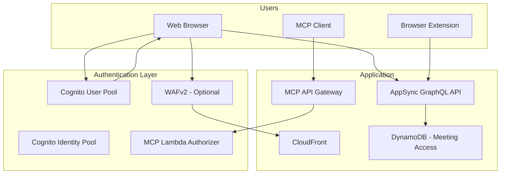

# Authentication & Access Control — Threat Analysis

## Document Information

| Field | Value |
|-------|-------|
| **Document Version** | 1.1 |
| **Last Updated** | 2026-11-25 |
| **Feature** | Amazon Cognito, JWT, roles (Admin, User, Participant), Meeting Access Control, access reviews |
| **Classification** | Internal |

## 1. Feature Overview

Authentication and access control in LMA includes:
- **Amazon Cognito User Pool**: User registration, authentication, MFA support
- **Cognito Identity Pool**: Federated identities for AWS resource access
- **Admin Group**: Cognito group for administrative access (VP launch, config management)
- **Roles**: every account has exactly one role, Admin, User or Participant, from its Cognito group membership; a pre token generation trigger writes it into every token, and the role matrix (`lma-ai-stack/source/appsync/role-matrix.json`) names the roles of every operation
- **Participant role**: read-only access to the meetings shared with the account, plus its own consents given in advance and its own voice enrollment
- **Participant accounts from a meeting's participant list**: a meeting's owner or an Admin can create Participant accounts for listed people who have none
- **Access review records**: last sign-in, last activity and MCP API key last use, shown on the User Management page and by `lma users list`
- **Self-Registration**: Optional with email domain restrictions
- **JWT Token Validation**: AppSync validates Cognito JWTs for all API requests
- **Meeting-Level Access**: Meeting owners can share access with specific users
- **MCP API Key Auth**: Separate API key authentication for MCP API Gateway
- **Optional WAFv2**: IP-based access control for CloudFront/ALB

## 2. Architecture

## 3. Threat Analysis

### AUTH.T01: Self-Registration Abuse

| Attribute | Value |
|-----------|-------|
| **Threat ID** | AUTH.T01 |
| **Category** | STRIDE: Spoofing |
| **Description** | LMA supports self-registration with email domain restrictions. If domain restrictions are misconfigured or bypassed, unauthorized users could register accounts and access meeting data. Additionally, email domain spoofing could bypass the restriction. |
| **Attack Vector** | Attacker registers with a spoofed email address matching the allowed domain, or exploits misconfigured domain restrictions to create an account. Once authenticated, they access shared meeting content and can use the meeting assistant. |
| **Impact** | Unauthorized access to meeting transcripts, ability to launch meeting recordings, access to organizational meeting history via KB |
| **Likelihood** | Medium (2) |
| **Severity** | High (3) |
| **Risk Score** | **6 (High)** |
| **Affected Components** | Cognito User Pool, self-registration configuration, email verification |
| **Existing Mitigations** | Email domain restriction (AllowedSignUpEmailDomain parameter), email verification required, Cognito pre-signup Lambda trigger (optional), admin group separately managed |
| **Status** | Mitigated |
| **Recommendations** | Implement pre-signup Lambda trigger for strict domain validation, consider disabling self-registration in production, add CAPTCHA to registration, enable Cognito advanced security for anomaly detection |

### AUTH.T02: JWT Token Theft / Session Hijacking

| Attribute | Value |
|-----------|-------|
| **Threat ID** | AUTH.T02 |
| **Category** | STRIDE: Spoofing, Information Disclosure |
| **Description** | JWT tokens stored in the browser (localStorage/sessionStorage) could be stolen via XSS attacks, browser extensions, or client-side vulnerabilities, enabling session hijacking and unauthorized access to meeting data. |
| **Attack Vector** | XSS vulnerability in the React UI allows attacker's JavaScript to read JWT tokens from browser storage. Attacker uses stolen tokens to make authenticated AppSync requests, accessing live transcriptions and meeting history. |
| **Impact** | Full session hijacking, access to all meetings the victim can access, ability to use meeting assistant as the victim, real-time eavesdropping on active meetings |
| **Likelihood** | Medium (2) |
| **Severity** | High (3) |
| **Risk Score** | **6 (High)** |
| **Affected Components** | React UI, browser storage, AppSync API, Cognito tokens |
| **Existing Mitigations** | Short-lived access tokens (1 hour), React framework XSS protection, HTTPS-only, Cognito token revocation capabilities, a Content-Security-Policy and other response headers on the web UI's distribution (see UI.T07) |
| **Status** | Mitigated |
| **Recommendations** | Keep the Content-Security-Policy narrow when customizing the web UI, use httpOnly cookies where possible, add token binding to client fingerprint, enable Cognito advanced security for compromised credential detection |

### AUTH.T03: Meeting Access Control Bypass

| Attribute | Value |
|-----------|-------|
| **Threat ID** | AUTH.T03 |
| **Category** | STRIDE: Elevation of Privilege |
| **Description** | Meeting-level access control (owner + shared users) is enforced at the application layer (AppSync resolvers, Lambda). If authorization checks are incomplete or bypassable, users could access meetings they weren't invited to. |
| **Attack Vector** | Attacker discovers meeting IDs (predictable patterns, API enumeration) and directly queries AppSync for meeting transcripts, bypassing UI-level access checks if resolver authorization is incomplete |
| **Impact** | Unauthorized access to specific meetings, transcript eavesdropping, privacy violation for meeting participants |
| **Likelihood** | Medium (2) |
| **Severity** | High (3) |
| **Risk Score** | **6 (High)** |
| **Affected Components** | AppSync resolvers, DynamoDB meeting access table, Lambda authorization logic |
| **Existing Mitigations** | AppSync resolver-level authorization checks, meeting access validation in Lambda, user-scoped DynamoDB queries, UUID meeting IDs (non-predictable), roles named on every GraphQL operation and tested against the role matrix (see AUTH.T07) |
| **Status** | Mitigated |
| **Recommendations** | Authorization audit of every GraphQL operation against the role matrix, add meeting access middleware to all data access paths, implement meeting ID opacity (no sequential patterns), add authorization unit tests |

### AUTH.T04: Admin Group Privilege Escalation

| Attribute | Value |
|-----------|-------|
| **Threat ID** | AUTH.T04 |
| **Category** | STRIDE: Elevation of Privilege |
| **Description** | The admin Cognito group grants extensive privileges including VP launch, MCP configuration, LLM template management, and user management. If a regular user can add themselves to the admin group, they gain full system control. |
| **Attack Vector** | Exploit misconfigured Cognito IAM policies that allow `cognito-idp:AdminAddUserToGroup` from non-admin contexts, or compromise the Cognito admin API to self-promote to admin group |
| **Impact** | Full system compromise — access to all meetings, ability to modify LLM templates, launch VPs, configure MCP servers, manage users |
| **Likelihood** | Low (1) |
| **Severity** | Critical (4) |
| **Risk Score** | **4 (Medium)** |
| **Affected Components** | Cognito User Pool, IAM policies, admin group |
| **Existing Mitigations** | IAM policies restrict Cognito admin operations to specific admin roles, CloudTrail logging of all Cognito admin API calls, admin group membership managed only through CloudFormation or direct console |
| **Status** | Mitigated |
| **Recommendations** | Regular audit of IAM policies with Cognito admin permissions, enable CloudTrail alerts for group membership changes, implement MFA requirement for admin operations, add detective control for unexpected admin group additions |

### AUTH.T05: WebSocket Authentication Weakness

| Attribute | Value |
|-----------|-------|
| **Threat ID** | AUTH.T05 |
| **Category** | STRIDE: Spoofing |
| **Description** | The WebSocket connection to the Fargate transcription server requires authentication. If the WebSocket authentication mechanism is weaker than the AppSync JWT validation (e.g., single-use tokens without expiration, or session-based auth without rotation), it creates an alternative attack surface. |
| **Attack Vector** | Attacker captures a WebSocket connection token and replays it to establish an unauthorized connection, or exploits long-lived WebSocket sessions that outlive the original JWT token lifetime |
| **Impact** | Unauthorized audio streaming (injecting fake transcripts), eavesdropping on active meeting audio via unauthorized connections |
| **Likelihood** | Low (1) |
| **Severity** | High (3) |
| **Risk Score** | **3 (Medium)** |
| **Affected Components** | ALB, Fargate WebSocket Server, WebSocket authentication tokens |
| **Existing Mitigations** | Meeting-specific connection tokens, TLS enforcement (WSS), ALB security groups, optional WAF |
| **Status** | Mitigated |
| **Recommendations** | Implement token expiration for WebSocket connections, add periodic re-authentication on long-running sessions, bind tokens to client IP/fingerprint, add connection duration limits |

### AUTH.T06: WAF Bypass / IP Restriction Evasion

| Attribute | Value |
|-----------|-------|
| **Threat ID** | AUTH.T06 |
| **Category** | STRIDE: Spoofing |
| **Description** | Optional WAFv2 provides IP-based access control. If WAF is the primary access restriction (without strong auth), attackers could bypass it through IP spoofing, proxy services, or accessing the ALB/AppSync directly without going through CloudFront/WAF. |
| **Attack Vector** | Attacker accesses the ALB or AppSync endpoint directly (bypassing CloudFront with WAF), or uses VPN/proxy from an allowed IP range to bypass IP restrictions |
| **Impact** | Bypass of network-level access controls, unauthorized access to LMA services |
| **Likelihood** | Low (1) |
| **Severity** | Medium (2) |
| **Risk Score** | **2 (Low)** |
| **Affected Components** | WAFv2, CloudFront, ALB, AppSync |
| **Existing Mitigations** | WAF is supplementary (not sole auth mechanism), Cognito authentication still required, ALB security groups restrict direct access, CloudFront geo restrictions |
| **Status** | Mitigated |
| **Recommendations** | Ensure WAF is defense-in-depth (not sole control), restrict ALB to CloudFront-only access, implement AppSync endpoint restrictions, document WAF as supplementary control |

### AUTH.T07: Participant Role Privilege Boundary

| Attribute | Value |
|-----------|-------|
| **Threat ID** | AUTH.T07 |
| **Category** | STRIDE: Elevation of Privilege |
| **Description** | The Participant role is for people who take part in meetings without capturing them, such as guests from another organization. A Participant account that could reach member operations (meeting sources, the Meetings Query Tool, MCP, configuration, AWS credentials from the identity pool, or the full meeting record) would hold more access than the role is meant to give. |
| **Attack Vector** | A signed-in Participant calls GraphQL operations, opens the WebSocket transcriber from the browser extension or the Desktop Capture App, requests identity pool credentials, or uses an MCP endpoint directly rather than through the pages the web UI shows them |
| **Impact** | Access to meetings or meeting content beyond those shared with the Participant, or the ability to start captures |
| **Likelihood** | Low (1) |
| **Severity** | High (3) |
| **Risk Score** | **3 (Medium)** |
| **Affected Components** | Cognito pre token generation trigger, AppSync schema, Cognito identity pool role mapping, WebSocket transcriber, MCP API key authorizer and OAuth gateway, web UI routes |
| **Existing Mitigations** | The pre token generation trigger writes exactly one role into every token (`cognito:groups`, and `lma_role` in the ID token) at every sign-in and token refresh, so a role change reaches tokens within an hour; every GraphQL query, mutation and subscription names the roles that may call it, and a field that names none is refused; the role matrix (`lma-ai-stack/source/appsync/role-matrix.json`) names the roles of every operation and entry point, and the schema and services are tested against it; the identity pool maps a Participant to a role that allows transcript translation (`translate:TranslateText`, `comprehend:DetectDominantLanguage`) and nothing else, and a token naming no role to no credentials; the transcriber answers `403` to a role that may not stream; the MCP API key authorizer reads the key owner's current groups on every request, and the MCP server refuses an OAuth caller whose role has no MCP access; a Participant reads meetings only through Participant operations that return allowlisted types (see UI.T06, REC.T09); LMA declares no Lambda function URLs, which a test enforces |
| **Status** | Mitigated |
| **Recommendations** | Keep the role matrix the single source of truth when adding operations; review the [role table](../../docs/user-based-access-control.md#roles) after each release; give external guests the Participant role rather than User |

### AUTH.T08: Participant Account Creation and Account Lookup from a Participant List

| Attribute | Value |
|-----------|-------|
| **Threat ID** | AUTH.T08 |
| **Category** | STRIDE: Elevation of Privilege, Information Disclosure |
| **Description** | A meeting's owner can see whether each person on the meeting's participant list has an LMA account, and can create Participant accounts for the listed people who have none. Used beyond its purpose, account creation could add accounts for arbitrary addresses or with a broader role, and the account status could be used to learn who has an account. |
| **Attack Vector** | A User repeatedly rewrites a meeting's participant list to look up many addresses, asks for accounts for addresses that are not on the list, or asks for a role other than Participant |
| **Impact** | Account sprawl in the user pool; disclosure of which addresses hold LMA accounts and with which role |
| **Likelihood** | Low (1) |
| **Severity** | Medium (2) |
| **Risk Score** | **2 (Low)** |
| **Affected Components** | User management Lambda (`createParticipantAccounts`, `getMeetingParticipantAccounts`), meetings table, Cognito user pool |
| **Existing Mitigations** | Only the meeting's owner (a User, for their own meetings, not those shared with them) or an Admin may call either operation; every address in a creation request must be on that meeting's list, or the request is refused as a whole; each new account is added to the `Participant` group only, an existing account is reported and left unchanged, and other roles and role changes stay with the Admin-only User Management operations; `AllowedSignUpEmailDomain` applies; at most 25 accounts per request and, for a User, 25 per day; at most 1,000 different addresses looked up per User per day, counted in items that keep only a hash of each address and expire after two days; the lookup answers only "no account" or the account's role; the user management role's Cognito actions are scoped to the LMA user pool |
| **Status** | Mitigated |
| **Recommendations** | Configure the user pool to send email through Amazon SES when inviting many people; include Participant accounts in access reviews (AUTH.T09) |

### AUTH.T09: Dormant Accounts and Unused API Keys Undetected in Access Reviews

| Attribute | Value |
|-----------|-------|
| **Threat ID** | AUTH.T09 |
| **Category** | STRIDE: Repudiation |
| **Description** | An access review needs to know which accounts and MCP API keys are still in use, so that unused ones can be disabled or deleted. Without a record of sign-in and activity, a dormant account or key would remain usable without anyone noticing. |
| **Attack Vector** | A former collaborator's account, or an MCP API key held by a departed user, stays enabled long after its last legitimate use and is later used by someone else |
| **Impact** | Continued access to meeting content through an account or key that should have been removed |
| **Likelihood** | Medium (2) |
| **Severity** | Medium (2) |
| **Risk Score** | **4 (Medium)** |
| **Affected Components** | Cognito PostAuthentication and pre token generation triggers, MCP API key authorizer, `UserSignInTable`, MCP API key table, User Management page, `lma users list` |
| **Existing Mitigations** | The PostAuthentication trigger records each user's last sign-in, and the pre token generation trigger and the MCP API key authorizer record each user's last activity (`LastActiveAt`) in `UserSignInTable`; the authorizer also records each key's last use (`LastUsedAt`); each write is a conditional update made at most once every 15 minutes, a single attempt bounded at 1.5 seconds, and never changes a token or an authorization decision; the triggers' and the authorizer's roles may only update items in the table; the User Management page and `lma users list` (table, CSV or JSON) show each user's role, status, last sign-in and last active time for a review; deleting a user on the User Management page removes their item; an MCP API key works only while its owner exists and holds a role with MCP access |
| **Status** | Mitigated |
| **Recommendations** | Run a periodic access review from `lma users list`; disable or delete accounts, and revoke keys, whose last activity is older than the organization's review period |

## 4. Security Controls Summary

| Control | Implementation | Threats Mitigated |
|---------|---------------|-------------------|
| **Email domain restriction** | Cognito AllowedSignUpEmailDomain parameter | AUTH.T01 |
| **Email verification** | Required for account activation | AUTH.T01 |
| **Short-lived tokens** | 1-hour access token lifetime | AUTH.T02 |
| **React XSS protection** | Framework-level protection + CSP | AUTH.T02 |
| **Resolver authorization** | Every GraphQL operation names its roles; resolvers apply per-meeting rules on top | AUTH.T03 |
| **UUID meeting IDs** | Non-predictable meeting identifiers | AUTH.T03 |
| **IAM-protected admin ops** | Cognito admin APIs restricted by IAM | AUTH.T04 |
| **CloudTrail logging** | Audit trail for auth operations | AUTH.T01, AUTH.T04 |
| **WSS/TLS** | Encrypted WebSocket connections | AUTH.T05 |
| **Defense-in-depth** | WAF + Cognito + resolver auth layered | AUTH.T06 |
| **Optional MFA** | Multi-factor authentication available | AUTH.T01, AUTH.T02 |
| **Role in every token** | Pre token generation trigger writes one role per token | AUTH.T07 |
| **Role matrix** | Roles named on every operation; schema and services tested against it | AUTH.T03, AUTH.T07 |
| **No-permission identity pool role** | Participants receive no AWS credentials from the identity pool | AUTH.T07 |
| **Participant account rules** | Owner or Admin only, listed addresses only, Participant role only, daily limits | AUTH.T08 |
| **Hashed lookup counters** | Daily account lookup limit kept as address hashes, expiring after two days | AUTH.T08 |
| **Access review records** | Last sign-in, last activity and API key last use in `UserSignInTable` and the key table | AUTH.T09 |
| **Access review export** | User Management page and `lma users list` | AUTH.T09 |
