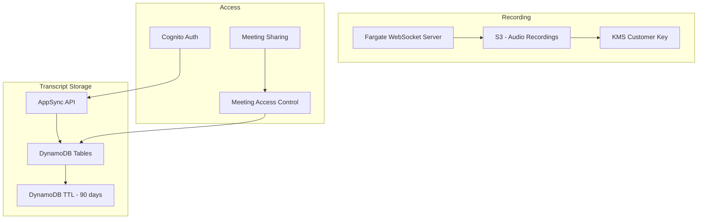

# Recording & Storage — Threat Analysis

## Document Information

| Field | Value |
|-------|-------|
| **Document Version** | 1.1 |
| **Last Updated** | 2026-11-25 |
| **Feature** | S3 Audio Recording, Meeting Data Storage, DynamoDB |
| **Classification** | Internal |

## 1. Feature Overview

Recording and storage covers the persistence layer for meeting data:
- **Audio recordings**: Stereo audio files stored in S3 (encrypted with KMS)
- **Meeting transcripts**: Full transcript text in DynamoDB with TTL
- **Meeting metadata**: Participant info, timestamps, settings in DynamoDB
- **AI outputs**: Summaries, action items, Q&A responses in DynamoDB
- **Data retention**: Configurable DynamoDB TTL (default 90 days)
- **Meeting sharing**: Access control for sharing meetings between users
- **Participant lists and automatic sharing**: each meeting can carry a participant list, and with Meeting Sharing on the meeting is shared, read-only, with the listed addresses (recorded on the meeting as `AutoSharedWith`)
- **Consent records**: the meeting's consent record, and consents given in advance, kept in the meetings table under each person's address
- **Deletion after the summary**: Retention settings that delete a meeting's transcript, its recordings, or both, once its summary is written
- **Point-in-time recovery window**: the `MeetingDataPointInTimeRecoveryDays` stack parameter sets how long deleted items in the tables that hold meeting content stay restorable

## 2. Architecture

## 3. Threat Analysis

### REC.T01: Unauthorized Audio Recording Access

| Attribute | Value |
|-----------|-------|
| **Threat ID** | REC.T01 |
| **Category** | STRIDE: Information Disclosure |
| **Description** | Audio recordings in S3 contain full meeting conversations. Unauthorized access to these recordings (via misconfigured S3 policies, compromised IAM roles, or leaked presigned URLs) exposes highly sensitive meeting content including verbal agreements, personal information, and confidential discussions. |
| **Attack Vector** | Overly permissive S3 bucket policy, IAM role with s3:GetObject on recording bucket used by multiple services, or presigned URL for audio playback intercepted/shared beyond intended recipient |
| **Impact** | Complete disclosure of meeting audio, corporate espionage, privacy violation, potential regulatory penalties |
| **Likelihood** | Low (1) |
| **Severity** | Critical (4) |
| **Risk Score** | **4 (Medium)** |
| **Affected Components** | S3 recording bucket, KMS key policy, IAM roles, presigned URLs |
| **Existing Mitigations** | Customer-managed KMS key encryption, S3 block public access, IAM least-privilege, presigned URLs with short expiration, CloudTrail data events |
| **Status** | Mitigated |
| **Recommendations** | Enable S3 access logging, implement S3 Object Lock for compliance, add VPC endpoint policy restricting bucket access, audit KMS key policy grants regularly, implement presigned URL generation with IP restrictions |

### REC.T02: Meeting Data Retention Compliance Violation

| Attribute | Value |
|-----------|-------|
| **Threat ID** | REC.T02 |
| **Category** | STRIDE: Information Disclosure, Repudiation |
| **Description** | DynamoDB TTL (default 90 days) handles automatic data deletion, but audio recordings in S3 may not have lifecycle policies aligned with retention requirements. Regulatory requirements (GDPR right to erasure, data minimization) may require earlier deletion. |
| **Attack Vector** | Compliance audit reveals meeting data retained beyond policy limits. Or, user requests data deletion (GDPR Article 17) but S3 recordings, DynamoDB records, and KB vectors are not all consistently deleted. |
| **Impact** | Regulatory non-compliance (GDPR, CCPA fines), legal liability from retained data, reputation damage |
| **Likelihood** | Medium (2) |
| **Severity** | High (3) |
| **Risk Score** | **6 (High)** |
| **Affected Components** | S3 recording bucket, DynamoDB (multiple tables), S3 Vectors (KB vectors), Bedrock KB |
| **Existing Mitigations** | DynamoDB TTL (configurable, default 90 days), S3 lifecycle policies (configurable), Retention settings that shorten the stack's periods but never lengthen them, **Delete the transcript after the summary** and **Delete the recordings after the summary** (every version of each recording file, in every capture session, and a recording stored after the deletion is deleted when it arrives), a record of each deletion on the meeting (`TranscriptDeletedAt`, `RecordingsDeletedAt`), retries with a dead-letter queue and an alarm for a deletion that does not complete, and the point-in-time recovery window of the meeting tables (see REC.T08) |
| **Status** | Partially Mitigated |
| **Recommendations** | Implement unified data deletion across all stores (S3 + DynamoDB + KB vectors), add meeting deletion API that purges from all locations, document data retention architecture, align TTL across all data stores, add retention compliance reporting |

### REC.T03: Recording Without Consent

| Attribute | Value |
|-----------|-------|
| **Threat ID** | REC.T03 |
| **Category** | STRIDE: Information Disclosure, Repudiation |
| **Description** | LMA records meeting audio by default when a connection is established. Meeting participants may not be aware they are being recorded, violating consent laws in two-party consent jurisdictions (e.g., California, EU, many countries). |
| **Attack Vector** | User starts LMA transcription for a meeting without informing other participants. Audio is recorded and stored without consent. Participants later discover recording and pursue legal action. |
| **Impact** | Legal liability (wiretapping/eavesdropping laws), regulatory fines (GDPR), civil lawsuits, reputation damage, invalidation of recorded content as evidence |
| **Likelihood** | High (3) |
| **Severity** | High (3) |
| **Risk Score** | **9 (Very High)** |
| **Affected Components** | Audio recording pipeline, S3 storage, meeting transcription initiation |
| **Existing Mitigations** | VP identifies itself in meeting participant list, configurable recording enable/disable, Meeting Consent modes (Off, Notify, Opt-in) with a consent record per meeting, objections that stop capture, evidence screenshots, presets that require each participant's consent, and consent given in advance with withdrawal on My consents (see REC.T07, VP.T07) |
| **Status** | Partially Mitigated |
| **Recommendations** | Implement mandatory consent notification mechanism (audio announcement, chat message), add configurable consent workflow (require acknowledgment before recording), provide recording indicator visible to all participants, document legal requirements in deployment guide, add consent audit trail |

### REC.T04: Meeting Sharing Over-Permission

| Attribute | Value |
|-----------|-------|
| **Threat ID** | REC.T04 |
| **Category** | STRIDE: Information Disclosure |
| **Description** | Meeting owners can share meeting access with other users. If sharing controls are coarse-grained (all-or-nothing) or if shared links don't expire, meetings containing sensitive content may be accessible to unintended recipients indefinitely. |
| **Attack Vector** | User shares a meeting containing sensitive discussion with a broad group. Shared access persists even after the person leaves the organization (if their account isn't deprovisioned). Or, sharing link is forwarded to unauthorized parties. |
| **Impact** | Sensitive meeting content accessible to unauthorized users, data leakage through over-sharing, persistent access beyond intended time |
| **Likelihood** | Medium (2) |
| **Severity** | Medium (2) |
| **Risk Score** | **4 (Medium)** |
| **Affected Components** | Meeting sharing mechanism, DynamoDB access control records, AppSync API |
| **Existing Mitigations** | User-level sharing (specific Cognito users), meeting owner can revoke access, access requires valid Cognito session, read-only Participant view of a shared meeting (see UI.T06), automatic sharing with listed participants removed when they leave the list (see REC.T06) |
| **Status** | Mitigated |
| **Recommendations** | Implement share expiration with configurable duration, add sharing audit trail, provide admin view of all shared meetings, implement automatic access revocation for deprovisioned users |

### REC.T05: DynamoDB Data Exposure via IAM

| Attribute | Value |
|-----------|-------|
| **Threat ID** | REC.T05 |
| **Category** | STRIDE: Information Disclosure |
| **Description** | DynamoDB tables contain meeting transcripts, summaries, and metadata. If Lambda execution roles have overly broad DynamoDB permissions, a compromised Lambda could read data from any meeting across all tables. |
| **Attack Vector** | Lambda function with broad DynamoDB read permissions (e.g., `dynamodb:GetItem` on `*`) is exploited via prompt injection or code vulnerability, allowing the attacker to read arbitrary meeting records |
| **Impact** | Bulk access to all meeting transcripts and metadata, cross-user data access |
| **Likelihood** | Low (1) |
| **Severity** | High (3) |
| **Risk Score** | **3 (Medium)** |
| **Affected Components** | DynamoDB tables, Lambda execution roles, IAM policies |
| **Existing Mitigations** | KMS encryption on all DynamoDB tables, IAM roles scoped to specific tables, least-privilege Lambda execution roles |
| **Status** | Mitigated |
| **Recommendations** | Audit Lambda IAM roles for DynamoDB scope, implement per-table IAM policies, add DynamoDB fine-grained access control where feasible, enable DynamoDB Streams monitoring for unusual access patterns |

### REC.T06: Automatic Sharing with a Meeting's Listed Participants

| Attribute | Value |
|-----------|-------|
| **Threat ID** | REC.T06 |
| **Category** | STRIDE: Information Disclosure |
| **Description** | With **Meeting Sharing › Share meetings with their listed participants** on (the default), a meeting is shared, read-only, with each address on its participant list as soon as the meeting record exists and whenever the list changes. An address on the list that does not belong to the intended person, or a share that outlives the person's removal from the list, would let someone read a meeting they should not. |
| **Attack Vector** | A participant list copied from a calendar invite includes an unintended or mistyped address, or a person is taken off the list after the meeting was shared with them |
| **Impact** | Read-only access to a meeting's transcript, summary, chat, recordings and consent record by someone outside the intended audience |
| **Likelihood** | Medium (2) |
| **Severity** | Medium (2) |
| **Risk Score** | **4 (Medium)** |
| **Affected Components** | Participant list (`updateCallParticipants` and the Virtual Participant inputs), meeting controls function, meetings table and its stream, `AutoSharedWith`, `meeting_sharing.shareWithListedParticipants` |
| **Existing Mitigations** | Only the meeting's owner or an Admin can change the list; each entry needs a well-formed address and a list holds at most 100 people; the meeting record keeps the addresses shared with automatically (`AutoSharedWith`), so taking someone off the list removes the share made for them, a share the owner made by hand is never removed this way, and someone the owner unshares by hand is not shared with again while they stay on the list; the meeting's owner is never added; every share, by hand or automatic, is saved on condition that the sharing list is still the one it was planned from; an Admin can turn the setting off on the Configuration page, and the owner can share and unshare by hand either way; a Participant sees a read-only page built from an allowlist that leaves out the owner's own material and the list's email addresses (see UI.T06); the setting is read for every change, and a change whose setting cannot be read is retried rather than made |
| **Status** | Mitigated |
| **Recommendations** | Review the participant list before a meeting starts, especially one pasted from an invite; turn the setting off on deployments where sharing should always be a deliberate act by the owner; see [Sharing with the participant list](../../docs/user-based-access-control.md#sharing-with-the-participant-list) |

### REC.T07: Consent Given in Advance Recorded for the Wrong Person or Beyond Its Terms

| Attribute | Value |
|-----------|-------|
| **Threat ID** | REC.T07 |
| **Category** | STRIDE: Spoofing, Repudiation |
| **Description** | A person on a meeting's participant list can consent before the meeting, signed in to LMA, from the meeting's consent link, for that meeting or for the organizer's meetings until a date, and withdraw it on **My consents**. A consent recorded for someone who did not give it, counted after it was withdrawn or past its date, or recorded without the exact text agreed to, would weaken the meeting's consent record. A person not on the list could also use the consent page to learn about a meeting, or the **Ask to be added** request to send unwanted requests. |
| **Attack Vector** | Someone opens a forwarded consent link; a consent is relied on after the person withdraws it; a person disputes which wording they agreed to; a person not on the list repeatedly asks to be added |
| **Impact** | A meeting captured on a consent that does not hold; a consent record that cannot show what was agreed to; disclosure of a meeting's name to someone not on its list |
| **Likelihood** | Low (1) |
| **Severity** | High (3) |
| **Risk Score** | **3 (Medium)** |
| **Affected Components** | Advance consent resolver, My consents page, consent records in the meetings table, meeting consent resolver, Cognito CustomMessage trigger, meeting notifications |
| **Existing Mitigations** | Consent needs sign-in, and a verified email address held by the user pool that is on the meeting's participant list (compared ignoring case); someone not on the list is told only that, with nothing about the meeting, and nothing is recorded about their consent; **Ask to be added** is shown in LMA only, never sent by email, at most once per meeting per person in 30 days and at most 20 times a day per person; a person cannot name another organizer, and a standing consent lasts at most **Longest consent given in advance, in days** (365 as shipped, 180 in the Regulated and Team-hosted presets); the consent is stored only if the text the person read is still the text the server would store (by its SHA-256 hash), and the record keeps the text, its hash and the version of the configured wording; a replaced consent is kept marked **Replaced**; withdrawal ends a consent at once and records an objection in each meeting in progress that counted it; deleting an account withdraws its consents; sign-in device details are not kept unless an Admin turns that setting on; each person reads only their own consents, under the address the user pool holds for them; Admins can turn consent given in advance off |
| **Status** | Partially Mitigated |
| **Recommendations** | Documented design limit: a consent given in advance is as good as the participant list and the sign-in, because the check is of the address the account holds, not of who is at the keyboard. Keep participant lists accurate, require MFA where the user pool allows it, and decide with whoever advises the organization on consent records whether consent given in advance suits the deployment; see [Consent given in advance](../../docs/meeting-consent.md#consent-given-in-advance) |

### REC.T08: Deleted Meeting Content Restorable from Point-in-Time Recovery

| Attribute | Value |
|-----------|-------|
| **Threat ID** | REC.T08 |
| **Category** | STRIDE: Information Disclosure |
| **Description** | DynamoDB point-in-time recovery lets someone with access to the AWS account restore a table, as a new table, to any second within its recovery period, including items since deleted by a meeting deletion, by **Delete the transcript after the summary** or by a time to live. For as long as the recovery period lasts, a deletion from those tables is not final. |
| **Attack Vector** | An AWS account principal with restore permissions restores the meetings table to a point before a transcript was deleted and reads it from the restored copy |
| **Impact** | Meeting content that the deployment's retention settings deleted is readable again, outside LMA's access rules |
| **Likelihood** | Low (1) |
| **Severity** | High (3) |
| **Risk Score** | **3 (Medium)** |
| **Affected Components** | Meetings table, Virtual Participant table and task registry, troubleshooting jobs table, voice enrollment table, AWS account IAM |
| **Existing Mitigations** | The `MeetingDataPointInTimeRecoveryDays` stack parameter sets the recovery period of the tables that hold meeting content, from 1 to 35 days (35 by default), or 0 to turn point-in-time recovery off on them so that a deletion leaves no restorable copy; lowering it takes effect at once; restoring a table needs AWS account permissions that LMA's users and roles do not hold; restore actions are recorded by CloudTrail; the tables that hold no meeting content keep a 35-day window so that a mistake can be undone |
| **Status** | Mitigated |
| **Recommendations** | Choose the recovery period with the deployment's retention policy: a short window keeps protection against mistakes while limiting the restorable copy, and 0 makes deletion final; restrict `dynamodb:RestoreTableToPointInTime` in the account; see [Point-in-time recovery of the DynamoDB tables](../../docs/privacy-and-data-handling.md#point-in-time-recovery-of-the-dynamodb-tables) |

### REC.T09: Recording Links Issued to Participants

| Attribute | Value |
|-----------|-------|
| **Threat ID** | REC.T09 |
| **Category** | STRIDE: Information Disclosure |
| **Description** | A Participant has no AWS credentials from the identity pool, so the server signs the links a Participant plays a shared meeting's recordings through. A link signed for a meeting that is not shared with the caller, for an object outside the recording prefixes, or for a long period, would disclose recordings beyond the share. |
| **Attack Vector** | A Participant asks for the recordings of a meeting not shared with them, or keeps a signed link after the meeting is unshared |
| **Impact** | Playback of a meeting's audio or video by someone the meeting is not shared with |
| **Likelihood** | Low (1) |
| **Severity** | Medium (2) |
| **Risk Score** | **2 (Low)** |
| **Affected Components** | `getParticipantMeetingRecordings` (participant meeting resolver), recordings bucket |
| **Existing Mitigations** | Only the Participant role may call the operation, and it answers only when the meeting's sharing list names the caller; it signs links only for the recordings the meeting record names, under the audio and video playback prefixes of this deployment's recordings bucket; each link is valid for one hour; the recordings' storage locations are not part of the Participant's view of the meeting; recordings deleted after the summary are no longer named on the meeting record, so no link is signed for them |
| **Status** | Mitigated |
| **Recommendations** | Unshare a meeting from a Participant as soon as access should end; remember that a link already issued remains valid until it expires, at most an hour |

## 4. Security Controls Summary

| Control | Implementation | Threats Mitigated |
|---------|---------------|-------------------|
| **KMS encryption** | Customer-managed key for S3 and DynamoDB | REC.T01, REC.T05 |
| **S3 block public access** | All public access blocked on recording bucket | REC.T01 |
| **IAM least-privilege** | Scoped bucket/table access per Lambda | REC.T01, REC.T05 |
| **DynamoDB TTL** | Configurable retention (default 90 days) | REC.T02 |
| **S3 lifecycle policies** | Configurable object expiration | REC.T02 |
| **Recording configuration** | Enable/disable recording per deployment | REC.T03 |
| **VP bot identification** | VP appears as identified bot in meetings | REC.T03 |
| **User-level sharing** | Share to specific Cognito users | REC.T04 |
| **Access revocation** | Meeting owner can revoke shared access | REC.T04 |
| **CloudTrail logging** | Data event logging for S3 and DynamoDB | REC.T01, REC.T05 |
| **Automatic sharing record** | `AutoSharedWith` on the meeting; removal from the list removes the automatic share | REC.T06 |
| **Meeting Sharing setting** | Admin can turn automatic sharing with listed participants off | REC.T06 |
| **Consent given in advance rules** | Verified, listed address; text hash check; longest period; withdrawal; rate-limited Ask to be added | REC.T07 |
| **Deletion after the summary** | Transcript and recordings deletion settings, with a record of each deletion | REC.T02 |
| **Recovery window** | `MeetingDataPointInTimeRecoveryDays` (0-35) on the tables that hold meeting content | REC.T08 |
| **Server-signed Participant links** | One-hour links, only for a meeting shared with the caller, only under the playback prefixes | REC.T09 |
