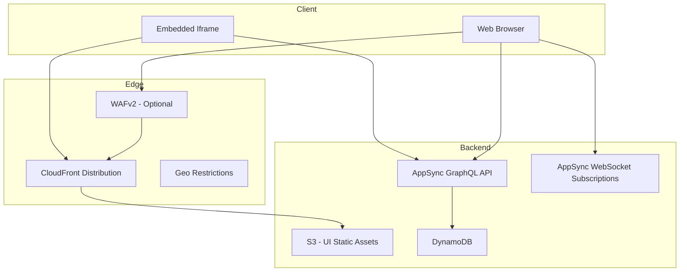

# Web UI — Threat Analysis

## Document Information

| Field | Value |
|-------|-------|
| **Document Version** | 1.1 |
| **Last Updated** | 2026-11-25 |
| **Feature** | React UI, CloudFront, AppSync GraphQL, Embeddable Iframes |
| **Classification** | Internal |

## 1. Feature Overview

The Web UI is the primary user interface for LMA:
- **React SPA**: Single-page application for meeting management and real-time viewing
- **CloudFront CDN**: Serves static assets with geo restrictions and optional WAF
- **AppSync GraphQL**: Real-time API with subscriptions for live meeting updates
- **Embeddable iframes**: Meeting components embeddable in external applications
- **Real-time subscriptions**: WebSocket-based subscriptions for live transcript streaming
- **Meeting inventory**: Browse, search, share, and manage meeting recordings
- **Participant pages**: a read-only home page, shared meetings list and meeting page for the Participant role, with a live transcript subscription of its own
- **My consents**: every role's own consents given in advance, a meeting's consent page opened from its consent link, and withdrawal
- **Response headers**: a CloudFront response headers policy with a Content-Security-Policy and cross-origin and transport headers

## 2. Architecture

## 3. Threat Analysis

### UI.T01: Cross-Site Scripting (XSS) via Transcript Content

| Attribute | Value |
|-----------|-------|
| **Threat ID** | UI.T01 |
| **Category** | STRIDE: Tampering, Information Disclosure |
| **Description** | Meeting transcripts may contain content that, when rendered in the React UI, could execute as JavaScript. Since transcripts come from spoken content (via Transcribe), special characters or script-like content could be transcribed and rendered unsafely. |
| **Attack Vector** | Meeting participant speaks content that gets transcribed as HTML/JavaScript (e.g., spelling out "<script>..." or exploiting ASR patterns). If the transcript is rendered with dangerouslySetInnerHTML or similar, XSS occurs. |
| **Impact** | JWT token theft, session hijacking, data exfiltration from the UI, defacement of meeting content |
| **Likelihood** | Low (1) |
| **Severity** | High (3) |
| **Risk Score** | **3 (Medium)** |
| **Affected Components** | React UI, AppSync (data delivery), transcript rendering components |
| **Existing Mitigations** | React's default XSS protection (auto-escaping JSX), transcript content treated as text (not HTML), CSP headers via CloudFront response headers |
| **Status** | Mitigated |
| **Recommendations** | Audit all transcript rendering for dangerouslySetInnerHTML usage, implement strict CSP with nonce-based scripts, add DOMPurify sanitization for any HTML rendering, regular security scanning of React components |

### UI.T02: AppSync Subscription Eavesdropping

| Attribute | Value |
|-----------|-------|
| **Threat ID** | UI.T02 |
| **Category** | STRIDE: Information Disclosure |
| **Description** | AppSync real-time subscriptions deliver live transcript segments and meeting updates over WebSocket. If subscription authorization is insufficient, an authenticated user could subscribe to other users' meeting updates. |
| **Attack Vector** | Authenticated user manipulates GraphQL subscription parameters to subscribe to a meeting they don't own/have access to, receiving real-time transcript updates from that meeting |
| **Impact** | Real-time eavesdropping on active meetings, access to live transcripts and AI summaries as they are generated |
| **Likelihood** | Medium (2) |
| **Severity** | High (3) |
| **Risk Score** | **6 (High)** |
| **Affected Components** | AppSync subscriptions, subscription authorization resolvers, meeting access control |
| **Existing Mitigations** | Subscription authorization in AppSync resolvers, user-scoped subscription filters, meeting ID validation against user access, roles named on every subscription, and a separate Participant subscription filtered on each message's sharing list (see UI.T06) |
| **Status** | Mitigated |
| **Recommendations** | Audit all subscription resolvers for proper authorization, implement server-side subscription filtering (not client-side), add integration tests for subscription access control, log subscription registration events |

### UI.T03: Iframe Embedding Security

| Attribute | Value |
|-----------|-------|
| **Threat ID** | UI.T03 |
| **Category** | STRIDE: Information Disclosure, Tampering |
| **Description** | LMA supports embeddable iframe components for integrating meeting views into external applications. If iframe security controls are insufficient, the embedded component could be exploited via clickjacking, token leakage to parent frames, or cross-origin data access. |
| **Attack Vector** | Attacker embeds LMA iframe on a malicious page, using clickjacking to trick users into performing actions. Or, misconfigured postMessage handlers leak meeting data to the parent frame's origin. |
| **Impact** | Clickjacking attacks on meeting controls, token/data leakage to embedding application, unauthorized actions performed via UI manipulation |
| **Likelihood** | Medium (2) |
| **Severity** | Medium (2) |
| **Risk Score** | **4 (Medium)** |
| **Affected Components** | Embeddable iframe components, CloudFront response headers, React UI |
| **Existing Mitigations** | Content-Security-Policy `frame-ancestors` of `'self'` plus the origins in the `AllowedEmbedOrigins` stack parameter (empty by default) in the web UI's response headers policy (see UI.T07), with `X-Frame-Options: DENY` while that list is empty; embed `postMessage` listeners accept messages only from the `allowedOrigins` query parameter's origins, or the embed's own origin when it is empty, and send events only to the first of them |
| **Status** | Mitigated |
| **Recommendations** | Keep `AllowedEmbedOrigins` to the exact origins that embed LMA, preferring exact hosts to a `*.` wildcard where the parent domain also serves sites the operator does not control; minimize data exposed through the iframe API |

### UI.T04: GraphQL API Abuse / Introspection

| Attribute | Value |
|-----------|-------|
| **Threat ID** | UI.T04 |
| **Category** | STRIDE: Information Disclosure, Denial of Service |
| **Description** | The AppSync GraphQL API exposes a rich query surface. Attackers could use introspection to discover the full schema, craft expensive queries to cause DoS, or exploit overly permissive queries to extract more data than intended. |
| **Attack Vector** | Attacker uses GraphQL introspection to map the full API schema, then crafts deeply nested or batched queries that consume excessive Lambda/DynamoDB resources, or discovers undocumented queries that expose additional data |
| **Impact** | API schema disclosure aiding further attacks, DDoS via expensive queries, unauthorized data access via discovered queries |
| **Likelihood** | Medium (2) |
| **Severity** | Medium (2) |
| **Risk Score** | **4 (Medium)** |
| **Affected Components** | AppSync API, DynamoDB, Lambda resolvers |
| **Existing Mitigations** | Cognito authentication required for all queries, AppSync built-in rate limiting, resolver-level authorization, query depth limits |
| **Status** | Mitigated |
| **Recommendations** | Disable GraphQL introspection in production, implement query complexity analysis, add per-user rate limiting, monitor for unusual query patterns |

### UI.T05: CloudFront Configuration Exposure

| Attribute | Value |
|-----------|-------|
| **Threat ID** | UI.T05 |
| **Category** | STRIDE: Information Disclosure |
| **Description** | The CloudFront distribution serves the React SPA which contains configuration endpoints (AppSync URL, Cognito Pool ID, region). While these require authentication to use, they provide reconnaissance information. Misconfigured CloudFront could also expose the S3 origin directly. |
| **Attack Vector** | Attacker inspects the React application's JavaScript bundles to extract configuration (AppSync endpoint, Cognito User Pool ID), then targets those services directly for further attacks |
| **Impact** | Reconnaissance information aiding targeted attacks, potential direct S3 access if OAC misconfigured |
| **Likelihood** | Medium (2) |
| **Severity** | Low (1) |
| **Risk Score** | **2 (Low)** |
| **Affected Components** | CloudFront, S3 UI bucket, React application bundles |
| **Existing Mitigations** | All exposed endpoints require Cognito authentication, CloudFront Origin Access Control (OAC) restricts direct S3 access, endpoints are not secret (security through access control, not obscurity) |
| **Status** | Accepted |
| **Recommendations** | Verify OAC is properly configured, ensure no sensitive data in client-side config; `X-Content-Type-Options` and `Strict-Transport-Security` are sent by the response headers policy (see UI.T07) |

### UI.T06: Participant Read-Only View and Live Transcript Subscription

| Attribute | Value |
|-----------|-------|
| **Threat ID** | UI.T06 |
| **Category** | STRIDE: Information Disclosure |
| **Description** | A Participant reads a shared meeting through operations of their own: the meeting list, a meeting's page, its transcript, its recordings and a live transcript subscription (`onAddParticipantTranscriptSegment`). If these returned fields beyond the read-only view, the owner's own material, or lines of a meeting no longer shared with the caller, a Participant would see more than the share is meant to give. |
| **Attack Vector** | A Participant selects extra fields in a GraphQL query or subscription, subscribes to a meeting not shared with them, or keeps a live transcript open after the meeting is unshared |
| **Impact** | Disclosure of the owner's material (meeting context, checklist, labels, assistant answers, sharing list, participant addresses) or of another meeting's transcript |
| **Likelihood** | Low (1) |
| **Severity** | High (3) |
| **Risk Score** | **3 (Medium)** |
| **Affected Components** | Participant meeting resolver, `participantTranscriptSubscription.js`, `ParticipantMeeting` and `ParticipantTranscriptSegment` types, Participant meeting page |
| **Existing Mitigations** | Only the Participant role may call the Participant operations, and the member operations (`getCall`, `getTranscriptSegments`, `onAddTranscriptSegment` and every other) refuse a Participant at the field; the Participant queries return types of their own, built from an allowlist rather than the meeting record with fields removed, so a field the meeting record gains reaches a Participant only when it is added to the allowlist; a meeting is answered only when its sharing list names the caller (owning a meeting is not enough for this role); the live subscription is admitted only while the meeting is shared with the caller and only for the fields a `ParticipantTranscriptSegment` has, and each message is filtered on the meeting, on the speech and meeting-chat channels and on the sharing list it is published with, so an unshared meeting stops reaching the page with the next line; the page reads the meeting again every 30 seconds while it is in progress; a Participant's meeting assistant question is answered from that meeting only, without the meeting context, checklist or Virtual Participant controls, and is not added to the transcript |
| **Status** | Mitigated |
| **Recommendations** | When adding a field to the meeting record, decide explicitly whether it belongs in the Participant allowlist; keep the live access tests for the Participant role in the integration suite; see [What a Participant sees of a shared meeting](../../docs/user-based-access-control.md#what-a-participant-sees-of-a-shared-meeting) |

### UI.T07: Browser-Side Script Loading, Framing and Transport Downgrade

| Attribute | Value |
|-----------|-------|
| **Threat ID** | UI.T07 |
| **Category** | STRIDE: Tampering, Information Disclosure |
| **Description** | The web UI renders meeting content (transcripts, chat, summaries, documents) that participants and models produce. Without restrictive response headers, injected content could load scripts or connect to origins the web UI does not use, a page could be framed by another site, a response could be interpreted as a different content type, or a connection could be made over plain HTTP. |
| **Attack Vector** | Content in a transcript or summary that a rendering library turns into markup; a third-party page that frames the web UI; a network position that downgrades a first connection |
| **Impact** | Script execution in a signed-in user's session, exfiltration of meeting content to another origin, clickjacking |
| **Likelihood** | Low (1) |
| **Severity** | High (3) |
| **Risk Score** | **3 (Medium)** |
| **Affected Components** | CloudFront distribution of the web UI, response headers policy `SecurityHeadersPolicy`, React SPA |
| **Existing Mitigations** | The distribution adds a response headers policy to every response: a Content-Security-Policy whose directives name each source the web UI uses (`script-src 'self'` with no `eval`, `object-src` and `base-uri` `'none'`, `connect-src` limited to the stack's AppSync, Cognito, S3 and other named AWS endpoints in the stack's Region and the few named external hosts), framing restrictions (`frame-ancestors 'self'` plus the `AllowedEmbedOrigins` origins, and `X-Frame-Options: DENY` while that list is empty), `Strict-Transport-Security`, `X-Content-Type-Options: nosniff`, `Referrer-Policy: strict-origin-when-cross-origin`, a `Permissions-Policy` that allows camera, microphone and display capture only for the web UI's own origin and denies other device features, and `Cross-Origin-Resource-Policy: same-origin`; the origin's `Server` header is removed; a unit test fails when the UI constructs an AWS SDK client whose service is not in `connect-src`, and an integration test checks the deployed headers |
| **Status** | Mitigated |
| **Recommendations** | When customizing the web UI, add each new origin to the matching directive rather than widening a directive; see [Response headers](../../docs/infrastructure-and-security.md#response-headers) |

## 4. Security Controls Summary

| Control | Implementation | Threats Mitigated |
|---------|---------------|-------------------|
| **React auto-escaping** | JSX default XSS protection | UI.T01 |
| **CSP headers** | Content-Security-Policy via CloudFront response headers | UI.T01, UI.T03 |
| **Subscription authorization** | AppSync resolver auth on subscriptions | UI.T02 |
| **Cognito authentication** | Required for all API operations | UI.T02, UI.T04, UI.T05 |
| **frame-ancestors** | CSP `frame-ancestors 'self'` plus `AllowedEmbedOrigins`; `X-Frame-Options: DENY` while that list is empty | UI.T03 |
| **Rate limiting** | AppSync built-in throttling | UI.T04 |
| **CloudFront OAC** | Origin Access Control for S3 | UI.T05 |
| **Geo restrictions** | CloudFront geographic access control | UI.T01, UI.T04 |
| **Optional WAF** | IP allowlisting and rate limiting | UI.T04 |
| **HTTPS only** | TLS 1.2+ enforced on all connections | All |
| **Participant operations** | Participant-only queries and subscription returning allowlisted types | UI.T06 |
| **Per-message sharing filter** | Participant live transcript filtered on the sharing list each line is published with | UI.T02, UI.T06 |
| **Response headers policy** | `SecurityHeadersPolicy`: CSP, HSTS, nosniff, framing, Referrer-Policy, Permissions-Policy, CORP | UI.T01, UI.T03, UI.T07 |
| **Header tests** | Unit test of `connect-src` against the UI's AWS clients; integration test of the deployed headers | UI.T07 |
